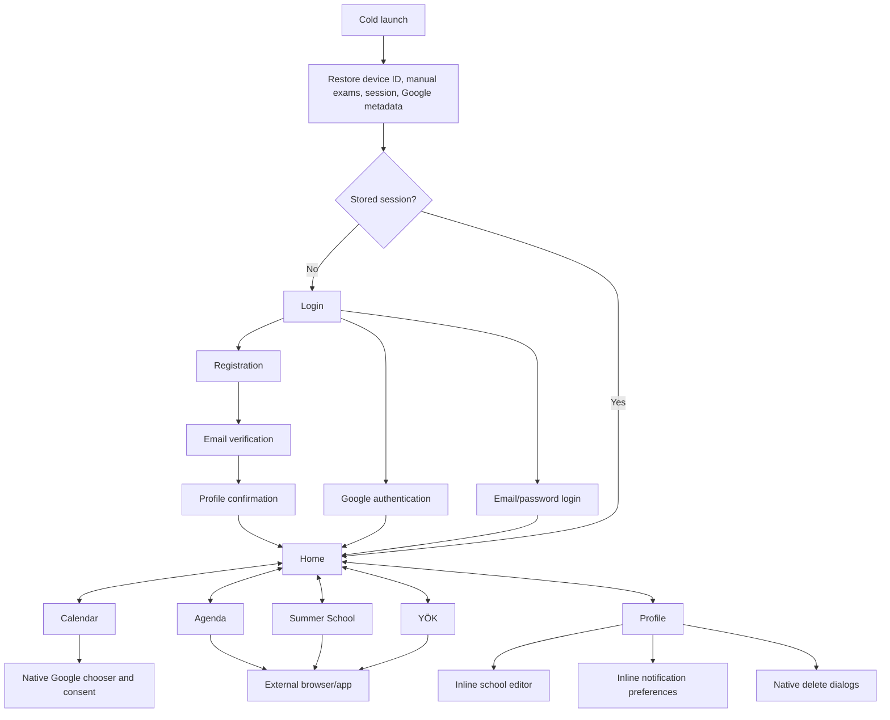

> [!WARNING]
> **HISTORICAL BASELINE — SUPERSEDED.** This entire document is a preserved audit of commit `cbd0067`; it does **not** describe the current application. Phases 2–8 are implemented. The current authenticated phone shell has four primary tabs: **Ana Sayfa**, **Duyurular**, **Takvim**, and **Profil**. Use the [current redesign README](./mobile-native-redesign/README.md) and the current Phase 1–8 reports: [Phase 1](./mobile-native-redesign/phases/phase-01-auth-session-integrity.md), [Phase 2](./mobile-native-redesign/phases/phase-02-content-trust.md), [Phase 3](./mobile-native-redesign/phases/phase-03-integrations.md), [Phase 4](./mobile-native-redesign/phases/phase-04-foundation.md), [Phase 5](./mobile-native-redesign/phases/phase-05-app-shell.md), [Phase 6](./mobile-native-redesign/phases/phase-06-auth-onboarding-ui.md), [Phase 7](./mobile-native-redesign/phases/phase-07-home.md), and [Phase 8](./mobile-native-redesign/phases/phase-08-content-feed.md).

# Mobile Native Current-State UI/UX and User-Flow Audit

Original audit date: 27 July 2026\
Current-state refresh: 29 July 2026\
Primary target: Android release-candidate client in `apps/mobile-native`\
Source baseline: branch `agent/google-play-readiness-20260724`, commit `cbd0067`
Implementation baseline: Expo 54, React Native 0.81.5, app version `0.1.1`, Android version code `12`

> **PRE-PHASE-1 BASELINE NOTICE:** This audit originated from the native source at commit `cbd0067` before Phase 1. The preserved **Historical pre-Phase-1 baseline** sections describe that snapshot, including its then-broken authentication/session behavior. The closure addendum before those historical sections is a source-derived orientation for frontend work, but [`mobile-native-redesign/phases/phase-01-auth-session-integrity.md`](./mobile-native-redesign/phases/phase-01-auth-session-integrity.md) and [`mobile-native-redesign/TEST_MATRIX.md`](./mobile-native-redesign/TEST_MATRIX.md) are authoritative wherever repaired Phase 1 behavior, tests, or native evidence conflict with this baseline. Phase 2 and the broad visual redesign have not started.

## Current source snapshot

Static inventory of the current `apps/mobile-native/App.tsx`:

| Measure | Current value | Counting convention |
|---|---:|---|
| Physical source lines | **6,126** | `Get-Content` line count after the password-recovery closure implementation |
| `Pressable` declarations | **56** | Lexical `<Pressable` occurrences; runtime lists create more controls |
| `TextInput` declarations | **15** | Lexical JSX declarations |
| `Switch` declarations | **2** | One category-row declaration repeats for every available category |
| Native `Alert.alert` declarations | **5** | Three defensive auth alerts (normally precluded by gating) and two reachable destructive confirmations |
| `StyleSheet.create` entries | **216** | Top-level style keys |
| Referenced style entries | **188** | Keys referenced through `styles.*` |
| Dormant style entries | **28** | Defined but not referenced |
| Distinct hard-coded color expressions | **63** | 62 hexadecimal literals plus one `rgba(...)` literal |

Current dormant keys: `stepLabel`, `selectionHint`, `sessionInfo`, `sessionText`, `universityCard`, `universityCardSelected`, `selectorCalendarRow`, `selectAllCalendarsButton`, `selectAllCalendarsText`, `cardMuted`, `calendarProviderGrid`, `calendarProviderCard`, `calendarProviderCardConnected`, `calendarProviderTopRow`, `calendarProviderTitle`, `calendarProviderDetail`, `calendarDetailsPanel`, `nativeCalendarPanel`, `calendarPanelHeader`, `nativeCalendarReminderGroup`, `reminderOption`, `reminderOptionActive`, `reminderOptionText`, `reminderOptionTextActive`, `label`, `buttonInline`, `secondaryOutline`, and `secondaryOutlineText`.

The previous figures—4,224 lines, 42 pressables, four alerts, 170 used styles, and 58 colors—belong only to the historical baseline. There is still no navigation library, page-view instrumentation, analytics SDK, component-level visual test suite, or native visual-regression suite.

| Native QA evidence | Closure result |
|---|---|
| Android Expo export | **Pass** — final post-recovery Android/Hermes export bundled 674 modules, 19 assets, and a 2.39 MB HBC bundle |
| Current debug assembly | `app:assembleDebug` for x86_64 **Pass**, 388.1 seconds |
| APK install/start | **Pass**; 105,428,719-byte SHA-256 `763148DA6A511220E4F37F5C57CF320458E208A90FC7AE2E525161E01B7D3A9D`; expected debuggable package `0.1.1`/12; MainActivity 1,083 ms; no immediate fatal/module/React JS crash |
| ADB/acceleration | Platform tools/ADB 36.0.2; WHPX `10.0.26200` installed and usable |
| Android environment | Official Stable Studio build `AI-261.25134.95.2612.15822958`; Emulator 36.6.11; exactly one API 24 Google APIs x86_64 AVD named `AcademicPhase1Low` |
| AVD display/resources | Requested 1,536 MB/2 cores/720 × 1280/320 dpi and 256 MB/2,047 MB heap/data; effective RAM/display/CPU match, but post-boot data config is 6,442,450,944 bytes and runtime heap/data are 384 MB/~5.8 GB |
| iOS simulator | Unavailable on the Windows host |
| Visible native QA status | Visible standalone Quick Boot **Pass** in 4.5 seconds; required installed auth/recovery/isolation/hierarchy/logout and width/font flows **Pass**. TalkBack is exactly BLOCKED because the retained image has no package/activity/service; no screen-reader acceptance is claimed |

## Current root views and state transitions

The current app has 14 captureable root surfaces: hydration loading/error; Login, Register, Verification, Password Recovery Request, Password Recovery Confirmation, and Profile Confirmation; and six authenticated tabs. Cleanup and global-message cards can coexist with the applicable root surface.

| Surface/state | Entry and current behavior | Visible state and recovery |
|---|---|---|
| Hydration loading | Always shown on cold launch. Device ID is restored first; a stored session is validated and refresh-rotated before owner storage and authenticated data load. | Centered spinner, “Uygulama hazırlanıyor,” explanatory copy; Login/Home does not flash underneath |
| Hydration error | A required session/device read, refresh, or startup operation fails outside a controlled expired/disabled-session outcome. | “Başlangıç tamamlanamadı,” safe error copy, and a labelled full-width `Tekrar Dene` action |
| Login | Hydration completed without a usable session, or user deliberately returned from verification/confirmation/recovery. | Email/password, 48 × 48 password visibility control, reachable `Şifremi unuttum`, `E-postamı doğrula`, email login, and Google entry/configuration notice |
| Register | User selects Register. | Full name/email/raw password; 10-character client/API parity; visibility control; disabled/busy states shared with Google auth |
| Password Recovery Request | User selects `Şifremi unuttum`; Android Back or explicit Cancel returns to Login. | Email validation, generic known/unknown request copy, busy spinner/label, 60-second resend cooldown, inline info/success/error panel |
| Password Recovery Confirmation | A recovery request is accepted. Android Back/`Geri` returns to the request step; Cancel returns to Login. | Six-digit numeric one-time-code input; 600-second expiry; new password plus confirmation; independent 48 × 48 visibility controls; inline parity/mismatch/invalid/expired/rate-limit feedback |
| Resumed verification | Registration/recovery persisted a valid non-secret record and the app relaunched signed out. | Email, expiry, and resend availability are restored; password and verification code are blank |
| Verification active/cooldown | Registration, unverified-login recovery, or `E-postamı doğrula` opens this stage. | Four-digit numeric entry, live expiry, live `m:ss` resend countdown, correct resend endpoint, controlled invalid/expired/rate-limit errors |
| Verification expired | Stored/server expiry reaches zero. | Timing panel says the code expired; resend becomes available when its independent cooldown reaches zero |
| Profile Confirmation | Verification succeeded. Verification and login are separate outcomes. | Success copy remains truthful; with a retained registration password the CTA attempts login, otherwise it returns to Login for password entry |
| Authenticated tabs | Session was freshly activated or stored session rotation completed. | Home, Calendar, Summer School, YÖK, Agenda, Profile; owner-generation checks suppress stale prior-account results |
| Cleanup issue | A controlled local cleanup/storage step fails during activation, logout, expiry, deletion, verification persistence, or manual-exam persistence. | Amber issue card names only safe target labels and offers `Temizliği Tekrar Dene` when a local retry is possible |
| Google disconnected/busy/connected | User starts Connect/Sync or account change; SDK account selection and Calendar scope precede direct REST synchronization. | Dedicated spinner, error panel, historical account email, verified/create/update/delete counts, warnings, and last-sync timestamp |
| Google account mismatch | A stored summary expects one email but the current cached SDK account differs and account change was not requested. | Owner summary is cleared, SDK sign-out is queued, and the user sees “Google hesabı değişmiş. Devam etmek için hesabını yeniden seç.” |
| Google chooser/consent cancellation | User cancels account selection or Calendar scope. | No new app summary is committed; dedicated copy says selection was not completed |

Authentication error copy is endpoint-aware and controlled. Invalid credentials, unverified email, invalid/expired verification code, invalid verification request, invalid/expired password-recovery code, password confirmation mismatch, invalid password, expired/invalid session, disabled account, rate limiting, Google configuration, Google cancellation, and Google verification failure do not render raw response bodies.

## Current dimensions, widths, colors, and control behavior

Let `V` be usable safe-area width. Root scroll content is `V − 28`. A standard Section is `V − 28` externally and approximately `V − 62` internally after its border and 16-unit padding. A generic button has no explicit width; React Native stretch in these column parents produces the widths below.

| Element | Current geometry | Current colors/type | State behavior |
|---|---|---|---|
| Canvas / scroll content | Full safe area; 14 horizontal, 10 top, 30 bottom padding; 14 gap; authenticated bottom clearance 142 | Canvas `#f5f6ff`; dark status-bar content | No max-width, breakpoint, landscape, or tablet rule |
| Standard Section | `V − 28`; radius 16; border 1; padding 16; gap 12; elevation 2 | White, border `#e2e8f0`; 17/800 title `#111827` | Existing reusable container |
| Hydration root | Full safe area; 24 horizontal padding; centered; gap 12 | `#f5f6ff`; title 20/800 `#111827`; body `#475569` | Polite live region |
| Hydration retry | `min(V − 48, 360)`; min height 50; radius 999 | **Global primary** `#4554e0`; white 15/700 | Labelled button; appears only in hydration error |
| Auth hero | `V − 28`; 18 horizontal / 22 vertical padding; radius 20; elevation 6 | `#4f46e5`; white 26/800 title; `rgba(255,255,255,0.75)` subtitle | Broad visual redesign deferred |
| Login/Register controls | About `(V − 70) / 2` each; gap 8; min height **48**; radius 999 | Active `#4554e0`/white; inactive `#f1f5f9`/`#64748b`; border `#e2e8f0` | Disabled at 0.5 opacity while email or Google auth is busy |
| Text input | About `V − 62`; min height **50**; radius 14; border 1.5; padding 14 horizontal / 13 vertical | White; border `#e2e8f0`; text `#111827`; auth/verification placeholder **`#64748b`**; non-auth placeholder remains platform default | Four-digit verification input uses numeric keyboard and max length 4 |
| Password input/control | Input width about `V − 62`; 58 trailing padding; overlaid control **48 × 48** at right 2 | Eye icon `#475569` | Label toggles between “Şifreyi göster” and “Şifreyi gizle”; password is never persisted |
| Base button | Parent width (usually `V − 62`, or `V − 96` inside Verification); min height **50**; radius 999; 16 horizontal padding; gap 8 | Variant-defined 15-unit label | Common disabled opacity 0.5 where applied |
| **Global primary button** | Same base width/height; applies to auth **and authenticated primary CTAs** | **`#4554e0`**, white 15/700, elevation 3 | This supersedes every historical row that calls `#5c6ef0` the primary-button color |
| Secondary button | Same base geometry | White; border 1.5 `#e2e8f0`; label `#1e293b` | Used by resend, cleanup retry, account change, and logout |
| Google button | Same base geometry | White; border 1.5 `#d1d5db`; label `#1f2937`/800; 19 icon | Busy label “Google açılıyor...” |
| Danger button | Same base geometry | `#be123c`; white 15/800; elevation 3 | Account deletion CTA |
| Text/recovery action | Parent width; min height **48** | `#4554e0`, 800 | Includes verification recovery and return-to-login actions |
| Verification card | About `V − 62`; radius 16; border 1; padding 16; gap 12 | White / `#e2e8f0`; title `#111827`; body `#475569` | Primary/secondary inner actions are about `V − 96` |
| Verification timing | Card inner width; radius 12; border 1; padding 12 horizontal / 10 vertical; gap 3 | `#eef2ff`, border `#c7d2fe`, text `#3730a3`/700 | Polite live region; expiry and resend clocks are independent |
| Login `Şifremi unuttum` | About `V − 62`; min height **48** | Transparent; label `#4554e0`/800 | Disabled with email/Google auth busy; opens Recovery Request and clears prior password/recovery secrets |
| Recovery Request/Confirm card | About `V − 62`; radius 16; border 1; padding 16; gap 12 | Same opaque verification-card surface | Inputs and primary/secondary actions are about `V − 96`; no new broad auth styling |
| Recovery code input | About `V − 96`; min height **50**; max length 6 | Standard white input/border/text and `#64748b` placeholder | Number pad, one-time-code semantics; non-digits are stripped |
| Recovery password rows | About `V − 96`; min input height **50**; 58 trailing padding | Standard input; eye icon `#475569` | New password and confirmation each have an independent overlaid **48 × 48** labelled visibility control |
| Recovery feedback | About `V − 96`; radius 12; border 1; padding 12 horizontal / 10 vertical | Info `#eef2ff`/`#c7d2fe`; success `#f0fdf4`/`#86efac`; error `#fff1f2`/`#fda4af`; text `#1e293b`/700 | Polite live region beside the active recovery action |
| Recovery validation | About `V − 96`; content height | `#be123c`, 700, line height 19 | Six-digit, 10-character, and confirmation-mismatch messages update inline |
| Cleanup issue card | `V − 28`; radius 14; border 1; padding 14; gap 8 | `#fffbeb`, border `#f59e0b`, title `#92400e`, body `#78350f` | Retry is disabled during cleanup/auth activity |
| Home quick action | About `(V − 38) / 2`; min height 104; radius 16 | White / `#dbeafe` | Four runtime cards |
| Home statistic | About `(V − 78) / 3`; min height 64; radius 14 | White / `#d1fae5`; value `#0f766e` | Three cards |
| Calendar/notification two-column card | About `(V − 72) / 2` | Existing per-card blue/white variants | No compact-width collapse rule |
| Refresh icon | **38 × 38**; radius 19 | White / `#e2e8f0`; 18 icon | Still below the desired 48-unit target |
| Agenda filter | Intrinsic width; min height **40**; radius 8 | Active **`#5c6ef0`**/white; inactive white/`#475569` | `#5c6ef0` remains a legacy accent here; it is no longer the primary-button fill |
| Bottom navigation | Left/right 8, bottom 16; shell radius 24, padding 5 × 6; six equal items, min height 58 | Active **`#5c6ef0`**; inactive `#94a3b8`; labels 9/11 | Item width about `(V − 41) / 6`; Android Back has no app handler |

Representative portrait widths are unchanged by Phase 1:

| `V` | Root card | Section button | Verification button | Mode control | Quick action | Home stat | Two-column card | Nav item |
|---:|---:|---:|---:|---:|---:|---:|---:|---:|
| 320 | 292 | 258 | 224 | 125 | 141 | 81 | 124 | 47 |
| 360 | 332 | 298 | 264 | 145 | 161 | 94 | 144 | 53 |
| 393 | 365 | 331 | 297 | 162 | 178 | 105 | 161 | 59 |
| 430 | 402 | 368 | 334 | 180 | 196 | 117 | 179 | 65 |
| 768 | 740 | 706 | 672 | 349 | 365 | 230 | 348 | 121 |

Password Recovery Request/Confirm inputs and filled actions use the **Verification button** column because they sit inside the same nested `verificationCard`: approximately 224 dp at `V=320`, 264 at 360, 297 at 393, 334 at 430, and 672 at 768. Login's `Şifremi unuttum` action uses the wider **Section button** column.

### Current password-recovery CTA inventory

| Surface | Control | Width/height | Color/type | State behavior |
|---|---|---|---|---|
| Login | `Şifremi unuttum` | About `V − 62`; min height 48 | Transparent; `#4554e0`, weight 800 | Disabled at 0.5 opacity during email/Google auth |
| Recovery Request | `Kodu İste` / `Yeni Kod İste` | About `V − 96`; min height 50; radius 999 | `#4554e0`; white 15/700; white small spinner while busy | Disabled for invalid email, active request, or resend cooldown; busy label `Kod isteniyor...` |
| Recovery Request | `İptal et ve giriş ekranına dön` | About `V − 96`; min height 48 | Transparent; `#4554e0`, weight 800 | Disabled while busy; clears recovery/password state |
| Recovery Confirm | `Şifreyi Yenile` | About `V − 96`; min height 50; radius 999 | `#4554e0`; white 15/700; white small spinner while busy | Disabled until six digits, ≥10-character password, exact confirmation, and unexpired code; busy label `Şifre yenileniyor...` |
| Recovery Confirm | `Yeni Kod İste` | About `V − 96`; min height 50; radius 999 | White; 1.5 `#e2e8f0`; `#1e293b`/700 | Disabled during cooldown/busy; countdown is included in label |
| Recovery Confirm | `Geri` | About `V − 96`; min height 48 | Transparent; `#4554e0`, weight 800 | Clears code/new-password fields and returns to Request |
| Recovery Confirm | `İptal et ve giriş ekranına dön` | About `V − 96`; min height 48 | Transparent; `#4554e0`, weight 800 | Clears all recovery state and returns to Login |
| Recovery Confirm | Two visibility controls | 48 × 48 each, overlaid at right 2; radius inherited from hit box | Eye icon `#475569`, size 21 | Independently labelled show/hide; disabled at 0.5 opacity while busy |

### Current literal color inventory

The 63 distinct source literals are:

`#0f172a`, `#0f5f80`, `#0f766e`, `#111827`, `#166534`, `#16a34a`, `#1d4ed8`, `#1e293b`, `#1f2937`, `#2563eb`, `#334155`, `#3442c4`, `#3730a3`, `#4338ca`, `#4554e0`, `#475569`, `#4f46e5`, `#5c6ef0`, `#64748b`, `#78350f`, `#86efac`, `#92400e`, `#94a3b8`, `#99f6e4`, `#9a3412`, `#9f1239`, `#a5b4fc`, `#b45309`, `#bae6fd`, `#bbf7d0`, `#be123c`, `#bfdbfe`, `#c7d2fe`, `#ccfbf1`, `#d1d5db`, `#d1fae5`, `#dbeafe`, `#dcfce7`, `#dde1fb`, `#e2e8f0`, `#ea580c`, `#ecfdf5`, `#eef0fd`, `#eef2ff`, `#eff6ff`, `#f0f9ff`, `#f0fdf4`, `#f0fdfa`, `#f1f5f9`, `#f59e0b`, `#f5f6ff`, `#f8fafc`, `#fda4af`, `#fde68a`, `#fecdd3`, `#fed7aa`, `#ffe4e6`, `#ffedd5`, `#fff1f2`, `#fff7ed`, `#fffbeb`, `#ffffff`, and `rgba(255,255,255,0.75)`.

There are still no semantic color tokens. Static contrast for the Phase-1 values is 5.84:1 for white on `#4554e0`, 4.76:1 for `#64748b` on white, and 8.88:1 for `#3730a3` on `#eef2ff`. Recovery text `#1e293b` is 13.08:1 on info `#eef2ff`, 13.97:1 on success `#f0fdf4`, and 13.32:1 on error `#fff1f2`; validation `#be123c` is 6.29:1 on white, and the `#475569` eye icon is 7.58:1 on white. Existing exceptions remain: `#94a3b8` on white is about 2.56:1; white on success `#16a34a` is about 3.30:1; 75%-white on `#4f46e5` is borderline; faint borders and the 9-unit navigation labels still need visual/accessibility remediation.

The UI describes the password rule as 10 characters. Technically both current client and API compare JavaScript string `.length`, so the threshold is 10 UTF-16 code units; input strings are not trimmed. Frontend copy/localization work should preserve user-friendly wording while tests retain that exact implementation boundary.

## Current state-completeness and open frontend work

| Flow | Loading/busy | Success | Error | Retry/current limitation |
|---|---|---|---|---|
| Startup | Dedicated blocking root | Commits Login/Home only after hydration | Dedicated blocking error root | Labelled retry; normal signed-out and valid-session hydration visual proof passed, while hard hydration-error/retry injection was not captured |
| Email login/register | Disabled actions; Google/email mutually exclusive | Controlled global success and session activation | Controlled endpoint-aware copy | Reachable verification and password-recovery entries; broad form redesign deferred |
| Password recovery | Request/confirm buttons disable while busy; request shows spinner/label; clocks update every second | Native successful reset cleared secrets, returned to Login, rejected old password, accepted new password, and revoked two held sessions | Native invalid-code feedback passed; automated expiry/mismatch/invalid-password/rate-limit contracts pass | Known/unknown status/body presentation, independent visibility, explicit Back/Cancel cleanup, and same-runtime revocation pass. Latency is not equalized; backend code consumption is atomic but later password/session/invalidation writes are not one transaction |
| Verification | Disabled submit/resend; live timing | Distinct verified confirmation | Invalid, expired, request-invalid, and rate-limit copy | Resend/recovery survive relaunch; pending-record storage failure is retryable |
| Session rotation | Hydration remains blocking; later 401 rotations coalesce | Replacement tokens serialize to storage | Expired/disabled session is cleared | Hard cleanup failure becomes hydration error |
| Manual exams | Owner restoration precedes writes | Owner-scoped v2 save | Storage failure becomes cleanup issue | Owner-unknown legacy exams are discarded, not reassigned |
| Logout/account deletion | Global busy; account mutations blocked | Durable tombstone precedes visible sign-out; pending verification is also deleted | Tombstone failure leaves account visibly signed in | Local cleanup retry exists; backend still lacks recent-auth challenge |
| Delete My Data | Waits for tracked authenticated mutations | Server deletion then owner reset; pending verification and owner local data are cleaned | Server failure keeps account/state available | Local cleanup failure remains visible and retryable |
| Google Calendar | Dedicated busy spinner; source requests cancellable | Verified counts, timestamp, warnings | Cancel, permission, service, auth, request, verification, empty, and account-mismatch states | Native chooser/consent itself cannot be programmatically dismissed; OAuth grant and already-created remote events are not removed by logout/deletion |
| Academic selection | Inline saving state; selectors disabled during global/selection busy | Parent-child hierarchy is validated and replaced | Controlled global error | Every native selection omits `classLevel`; replacement therefore clears an existing class level until a future class-level UI is added |

Broad visual work remains intentionally open: 38-unit refresh targets, 40-unit filters, 9-unit navigation labels, low-contrast inactive navigation, inconsistent pressed/focus/disabled treatment outside repaired paths, no keyboard-avoidance layout, no responsive max width, no dark theme, no route stack, and no first-party page analytics.

## Current page-view capture register

The register contains **39 unique `PV-C*` page/state rows**. It is deliberately state-based rather than route-based because the app has no navigation router and several logical pages are conditional branches inside one mounted `App` component.

The installed-app register below is reconciled with the Phase 1 native evidence. `PASS` is limited to a directly exercised state; `BLOCKED` names a missing required substate; `NOT CAPTURED` marks broader frontend evidence outside this closure and is not a Phase 1 result. Exact hashes and device metadata belong in the [Phase 1 native evidence register](./mobile-native-redesign/evidence/phase-01-native/README.md).

| ID | Required current page/state | What the capture must prove | Screenshot | Recording | Result/notes |
|---|---|---|---|---|---|
| PV-C01 | Hydration loading, no stored session | No Login flash; safe area, spinner, live-region copy | Timestamped clear-data observation | — | PASS for no-Home flash; loading surface not retained as a clean still |
| PV-C02 | Hydration hard error and retry | Error copy, `min(V − 48, 360)` retry, retry transition | — | — | NOT CAPTURED — deterministic helper/source tests pass; native hard-error injection was not run |
| PV-C03 | Valid stored session launch | Device-ID-first restore, token rotation, then Home | `C:\tmp\hydration-immediate-2.png`; `hydration-final-2.png` | — | PASS — loading/bundle then Home, no Login flash |
| PV-C04 | Expired/disabled stored session | Safe cleanup and final Login without prior-account content | `C:\tmp\expired-session.xml` | — | PASS for expired session; disabled-account fixture not separately captured |
| PV-C05 | Login empty/filled/password hidden/shown | Input widths, 48 × 48 eye control, disabled/enabled actions | PNG register plus `C:\tmp\password-hidden.xml`; `password-visible.xml` | — | PASS — blank/filled and hide→show semantics/labels captured |
| PV-C06 | Login busy and controlled failures | Invalid credentials, unverified recovery, disabled, rate-limit copy | `C:\tmp\login-old-rejected.png`; `unverified-login-result.png` | — | PARTIAL, non-gating — invalid credentials and unverified-account outcomes are directly distinct; disabled-account/429 remain deterministic automated contract evidence |
| PV-C07 | Register empty/short/valid/password shown | Ten-character parity, raw-space behavior, alert/banner hierarchy | `C:\tmp\layout-320-register.png`; `font-200-register-fields.png`; `register-password-hidden.xml`; `register-password-visible.xml`; `register-password-restored.xml` | — | PASS for required geometry/readiness/visibility; raw-space parity remains automated contract evidence |
| PV-C08 | Verification restored after relaunch | Email restored; password/code absent; live expiry/cooldown | `C:\tmp\verification-recovered.png` | — | PASS |
| PV-C09 | Verification invalid/expired/request-invalid | Four-digit input, exact safe copy, resend recovery | `C:\tmp\verification-invalid-fast.png`; `unverified-login-result.png`; `expired-session.xml` | — | PASS within fixture boundary — invalid code, expired-state presentation, and expired-session distinction are native; server-expired/request-invalid branches are seeded automated evidence because the runtime has no time injection |
| PV-C10 | Resend cooldown and rate limit | `m:ss` label, disabled button, server `resendAvailableAt` recovery | `C:\tmp\verification-resend-ready.png`; `verification-resend-recovered.png` | — | PARTIAL, non-gating — cooldown/resend/relaunch are direct; native 429 presentation was not separately captured and remains contract evidence |
| PV-C11 | Verification success then login failure | Verified confirmation remains distinct from later login error | `C:\tmp\separation-verification-success.png`; `separation-login-failure.png` | — | PASS — verified success remained distinct from the later stale-password Login failure |
| PV-C12 | Cleanup issue and retry | Safe target labels, retry disabled/busy/success/failure | — | — | NOT CAPTURED — automated timeout/failure/retry contracts pass; native storage-failure injection was not run |
| PV-C13 | Home without academic profile | Current guidance, zero/loading/empty distinctions | — | — | NOT CAPTURED — frontend evidence backlog outside Phase 1 closure |
| PV-C14 | Home populated and manual-exam add | Cards, keyboard, owner-scoped save success/error | `C:\tmp\exam-a-added.png`; `exam-a-relaunch.png`; `exam-b-added.png`; `user-a-return.png` | — | PASS for save/persistence/isolation; storage-error state not injected |
| PV-C15 | Calendar loading/error/empty | Refresh target, state coexistence, eight-item limit | — | — | NOT CAPTURED — frontend evidence backlog outside Phase 1 closure |
| PV-C16 | Google disconnected + account chooser | Platform chooser handoff and cancellation return | — | — | NOT CAPTURED — Phase 3 evidence backlog |
| PV-C17 | Google Calendar consent grant/deny | Scope sheet, denial/cancel copy, app return | — | — | NOT CAPTURED — Phase 3 evidence backlog |
| PV-C18 | Google syncing/connected/partial warning | Spinner, account, verified counts, warnings, last sync | — | — | NOT CAPTURED — Phase 3 evidence backlog |
| PV-C19 | Google account mismatch | Summary clear, sign-out/reselect message, no stale success | — | — | NOT CAPTURED — Phase 3 evidence backlog |
| PV-C20 | Summer School loading/populated/empty/error | Current cards, missing links, external handoff | — | — | NOT CAPTURED — Phase 2 evidence backlog |
| PV-C21 | YÖK loading/populated/empty/error | Feed density, refresh, link handoff | — | — | NOT CAPTURED — Phase 2 evidence backlog |
| PV-C22 | Agenda every filter and long content | Filter sizing/overflow, grouping, external links | — | — | NOT CAPTURED — Phase 2/frontend evidence backlog |
| PV-C23 | Profile default and academic editor | Selector busy/disabled states and descendant clearing | `C:\tmp\hierarchy-a-reload.xml`; `hierarchy-b-reload.xml`; `font-200-profile.png` | — | PASS for required university/faculty descendant replacement/relaunch |
| PV-C24 | Existing class level then any school selection | `classLevel` clears rather than silently becoming 2 | Isolated API responses plus hierarchy relaunch XML | — | PASS — server response/native relaunch contained no old class/descendants |
| PV-C25 | Notification modes/categories/save | Switches, long list, busy/error/success visibility | — | — | NOT CAPTURED — frontend evidence backlog outside Phase 1 closure |
| PV-C26 | Logout storage failure then retry | Account stays visible until tombstone succeeds | — | — | NOT CAPTURED — normal logout/wait/relaunch and automated tombstone failure/retry pass; native SecureStore injection was not run |
| PV-C27 | Delete My Data alert/cancel/success/cleanup failure | Server-first result, account remains active, local retry | — | — | NOT CAPTURED — destructive-flow visual backlog |
| PV-C28 | Delete Account alert/cancel/success/failure | Fail-closed session handling and recent-auth gap | — | — | NOT CAPTURED — destructive-flow visual backlog |
| PV-C29 | External browser/app open, consent/chooser, return | Handoff, Android Back/return, retained tab/scroll | — | — | NOT CAPTURED — frontend evidence backlog |
| PV-C30 | 320/360/393/430 dp portrait widths | Exact formulas, nav crowding, clipping/wrapping | Default hash set; `C:\tmp\layout-320-*.png` | — | Phase 1 required 360/320 PASS; 393/430 NOT CAPTURED outside this closure |
| PV-C31 | 200% font scale and screen reader | Labels, live regions, control names, truncation | Six-surface `font-200-*` capture set; exact TalkBack text blocker | — | Font set PASS for reachability; Home nav labels wrap/truncate. TalkBack runtime BLOCKED on selected image; no screen-reader acceptance |
| PV-C32 | Tablet/iPad width | Missing readable-width cap and platform shadow difference | — | — | NOT CAPTURED — tablet/iOS evidence backlog |
| PV-C33 | Profile Confirmation: retained password vs restored/no password | CTA changes truthfully between `Giriş Yap ve Başla` and `Giriş Ekranına Geç`; later login failure stays separate from verification success | `C:\tmp\separation-verification-success.png`; `separation-login-failure.png`; verification relaunch hierarchy | — | PARTIAL, non-gating — retained-password CTA and later Login-failure separation are direct; restored/no-password CTA remains source/automated contract evidence |
| PV-C34 | Login with `Şifremi unuttum` | Reachability, width `V − 62`, 48-unit target, enabled/disabled state | `C:\tmp\after-forgot-tap.png`; `layout-320-recovery.png` | — | PASS for reachability and request transition |
| PV-C35 | Recovery Request empty/invalid/valid/busy | Generic email request, `V − 96` controls, inline validation, spinner and busy label | `C:\tmp\after-forgot-tap.png`; `recovery-entered.xml`; `recovery-code.png`; `layout-320-recovery.png` | — | PARTIAL, non-gating — empty/invalid/valid/known/unknown transitions are direct; the transient busy frame was not frozen |
| PV-C36 | Recovery request known vs unknown fixture | Same production status/body fields and native presentation without a direct response-field enumeration signal | Known capture plus unknown request/confirm UI hierarchy; sanitized runtime parity record | — | PASS for status/body/presentation parity — same-runtime public fields were identical. Latency was not equalized or accepted; timing-based inference remains an open risk |
| PV-C37 | Recovery Confirmation default/invalid/expired/rate-limited | Six-digit keyboard, 600-second expiry, 60-second resend, controlled nearby errors | `C:\tmp\recovery-invalid-message.png`; `recovery-resend-ready.png`; `font-200-recovery-confirm-actions.png` | — | PASS for native invalid/cooldown/timing; server expiry/rate-limit branches remain seeded automated evidence |
| PV-C38 | Recovery new-password/confirmation hidden/shown/mismatch | Independent 48 × 48 visibility labels, 10-character parity, inline mismatch | `C:\tmp\recovery-fields.png`; `recovery-after-new.png`; `recovery-passwords-visible.xml`; `recovery-passwords-current.xml` | — | PASS — both fields independently exposed labelled hide/show/rehide states; mismatch/parity passed |
| PV-C39 | Recovery Back/Cancel/success and old/new Login | Android Back and explicit controls clear secrets; success returns Login; old fails/new succeeds | `C:\tmp\recovery-after-explicit-back2.xml`; `recovery-after-cancel.xml`; `recovery-success-final.png`; `login-old-rejected.png`; `login-new-accepted.png` | — | PASS — explicit Back/Cancel removed benign markers, success/old-new passed, and hardware Back shares the focused-test cleanup handler |

Copy this fillable metadata block for every `PV-C*` row:

| Field | Value |
|---|---|
| `page_view_id` |  |
| `screen_name` |  |
| `previous_screen_name` |  |
| `entry_point` |  |
| `captured_at` |  |
| `platform` |  |
| `device_model` |  |
| `os_version` |  |
| `logical_width_height` |  |
| `orientation` |  |
| `density` |  |
| `font_scale` |  |
| `theme` |  |
| `network_fixture` |  |
| `account_fixture` |  |
| `app_version` |  |
| `native_build_number` |  |
| `git_head` |  |
| `state_fixture` |  |
| `screenshot_path` |  |
| `recording_path` |  |
| `reviewer` |  |
| `result` |  |
| `redaction_status` |  |
| `notes` |  |

---

## Historical pre-Phase-1 baseline — 1. Executive summary

> Historical evidence only. “Current” in the preserved text below means the 27 July `cbd0067` snapshot, not the post-Phase-1 working tree.

The Android-facing product is implemented in [`apps/mobile-native/App.tsx`](../apps/mobile-native/App.tsx), not in the parallel responsive web client under `apps/mobile`. The native app currently has 10 user-visible views: four unauthenticated account stages and six authenticated tabs. They are not real routes; one 4,224-line component conditionally swaps content inside one persistent `ScrollView`.

The UI has a recognizable card-based visual language, useful empty-state copy, direct Google Calendar synchronization, profile-based academic filtering, and destructive-account controls. It also has several confirmed problems that must be resolved before visual polishing becomes the primary work:

1. **Email verification recovery is broken.** “Resend code” calls registration again instead of the backend resend endpoint.
2. **The notification UI does not register a device for notifications.** It saves preferences only; it never requests OS permission or obtains/registers a push token.
3. **Manual exams can be lost on startup and can cross user accounts on a shared device.** The storage write races restoration and the storage key is not user-scoped.
4. **Authentication/session cleanup is incomplete.** Logout and refresh failure leave user-specific state in memory, and overlapping asynchronous work can write stale account data back after logout.
5. **The current Android version metadata may have moved backward.** Version codes 13 and 14 exist in local artifacts, while the latest alias and committed config are code 12. Play Console must establish the highest uploaded code before another release.

The visual layer is also not yet a design system. The file contains 170 used styles, 28 dormant styles, and 58 distinct hard-coded color values. Primary color roles drift between purple, indigo, blue, teal, orange, and rose. Several core combinations fail normal-text contrast; important touch targets are 36–40 dp; no control exposes explicit accessibility semantics; and the six-item bottom navigation uses 9 dp labels.

This report is intentionally source-derived. There is no current native emulator/device screenshot set in the repository, and the prior `firebase-live-app-visuals` captures are from the separate web client. Section 13 provides page-view capture slots so screenshots can be added without changing the audit structure.

## Historical pre-Phase-1 baseline — 2. Scope, evidence, and confidence

### 2.1 Authoritative frontend

| Target | Current role | Audit treatment |
|---|---|---|
| `apps/mobile-native` | Expo/React Native source used for the APK/AAB artifacts | **Primary baseline** |
| `apps/mobile` | Separate Vite responsive web client, still independently deployable | Out of scope for native dimensions and flow |
| `firebase-live-app-visuals/*.png` | July 10 web login/register captures | Historical web reference only |
| `NATIVE_CALENDAR_INTEGRATION_PREVIEW.png` | Designed mockup of a now-dormant device-calendar concept | Not runtime evidence |

The latest APK alias contains the current July feature markers, including `/me/data`, account deletion, Google Calendar, Summer School, and the current content views. That confirms the present `App.tsx` is the appropriate as-built code baseline even though the release metadata was rolled back.

### 2.2 Verification completed

| Check | Result |
|---|---|
| `npm run typecheck:mobile:native` | Pass |
| Effective Expo public config | Resolves as app `0.1.1`, Android code `12`, portrait, light-only, edge-to-edge |
| Expo web diagnostic export | Pass; proves the source bundles, but is not accepted as native visual evidence |
| Current native runtime capture | Not available: no working ADB/emulator was available and none is stored in the repo |
| Native UI/component tests | None |
| Native visual-regression tests | None |
| Screen analytics/page-view instrumentation | None found |

### 2.3 Measurement convention

React Native numeric layout values in this report are logical device units: dp on Android and points on iOS. Width formulas use `V`, the usable safe-area width. Actual pixels depend on device density. Font rendering, platform `Switch` styling, safe-area insets, and Android-only elevation must still be checked on devices.

## Historical pre-Phase-1 baseline — 3. Information architecture

Important implementation facts:

- There is no navigation library, stack, route history, deep-link handler, or screen-level lifecycle.
- One `ScrollView` remains mounted while `activeTab` changes (`App.tsx:1952–1960`, `2991–3019`). Scroll-to-top and per-tab scroll restoration are not implemented.
- Android back behavior is not handled. From a secondary tab, back is therefore not designed to return Home.
- The declared `academicpulse` scheme is not connected to any route handling (`app.json:3–7`).
- Authenticated content receives 142 dp bottom padding to clear an absolutely positioned floating navigation bar (`App.tsx:3031–3039`, `4185–4197`).

## Historical pre-Phase-1 baseline — 4. View inventory and flow behavior

### 4.1 Shared unauthenticated shell

All four account stages show the same purple welcome hero. A global message banner is inserted below the hero and above the active card. It disappears after 3.5 seconds (`App.tsx:829–833`, `1961–1972`). Because it is part of scroll content rather than a fixed toast/live region, feedback from an action below the fold can be invisible.

### 4.2 View 1 — Login

Source: `App.tsx:1974–2012`, `2089–2133`

Current content:

- Login/Register segmented control.
- Google sign-in above the email form when configured; otherwise a yellow configuration notice.
- Email and password inputs.
- Full-width primary “Giriş Yap” action.
- Caption explaining that both fields are required when the action is disabled.

Current behavior and gaps:

- Readiness checks only whether email and password are non-empty.
- There is no password visibility control, forgot-password flow, field-level error state, privacy/terms entry, or direct recovery path for an unverified account.
- Email and password values survive switching between Login and Register.
- Email login has no spinner or progress label; the normal button is only dimmed.
- Google changes its label to “Google açılıyor...”.
- The Google chooser and email login can overlap because the email action does not check `googleBusy`.

### 4.3 View 2 — Registration

Source: `App.tsx:2013–2088`, `1090–1153`

Current content:

- Two progress chips labelled Profile and Verification.
- Full name, email, and password fields.
- Full-width primary “Hesap Oluştur” action.
- A notice that school selection happens after entering the app.
- A notice explaining that email verification follows.

Current behavior and gaps:

- Frontend validation requires only non-empty values. The password placeholder recommends eight characters but the client does not enforce or explain the real password rules.
- There is no password confirmation, strength/help text, or inline validation.
- Registration success opens the verification view.
- School selection is deliberately deferred, but there is no mandatory academic onboarding later; the user lands on an empty Home.

### 4.4 View 3 — Email verification

Source: `App.tsx:2136–2173`, `1237–1327`

Current content:

- Both progress chips displayed as completed.
- Free-form verification-code input.
- Primary “Doğrulamayı Tamamla”.
- Secondary “Kodu Tekrar Gönder”.
- Text action to edit registration details.

Current behavior and gaps:

- The API requires a four-digit code, but the field has no numeric keyboard, `maxLength`, one-time-code autofill, resend countdown, or expiration display.
- `verificationExpiresAt` is returned by the API but never retained or displayed.
- Both steps look complete before verification actually succeeds.
- **Confirmed defect:** resend calls `POST /auth/register` (`App.tsx:1237–1268`), while the backend route is `POST /auth/resend-verification-code` (`auth.controller.ts:21–23`). Register rejects the already-created email.
- Verification and the follow-up login run in one `try` block. If verification succeeds but login fails, the app reports verification failure; retrying the consumed code can fail again.
- Returning to edit clears the verification state. Re-registering the same email conflicts, so the user can be stranded.

### 4.5 View 4 — Profile confirmation

Source: `App.tsx:2175–2207`, `1329–1356`

Current content:

- Completed Profile/Verification progress chips.
- Full name and email summary.
- Primary “Profili Onayla ve Başla”.
- Text action to edit information.

This is an extra confirmation of already-created identity data, not academic profile setup. Confirming activates the pending session and opens Home. Editing abandons the pending session and returns to registration, where the same email can no longer be registered.

### 4.6 View 5 — Home

Source: `App.tsx:2209–2343`

Current content:

- Greeting hero and three statistics: today, exams, announcements.
- Four two-column shortcut cards: Calendar, Announcements, Summer School, YÖK.
- Exam Focus section with nearest exam, up to three more exams, manual exam name/date fields, and “Sınav Ekle”.
- Upcoming Events section with refresh icon, spinner/error, a featured nearest event, and remaining results.

Current behavior and gaps:

- A new user without a university is not given a primary school-selection CTA. The page instead shows zero counts and generic empty content.
- Home counts show zero while startup data is loading; there are no skeletons.
- “No upcoming exams” can appear while calendar loading is still in progress or after an error.
- Upcoming Events has no explicit success-empty state.
- Manual exam entry is plain text, accepts JavaScript-parsable dates rather than strict `YYYY-MM-DD`, and has no picker, edit, delete, or source label.
- Countdown values have no timer, so they become stale until another render.
- Date-only events can disappear at UTC midnight rather than remaining present for the local calendar day.
- Manual exams are not included in Google Calendar synchronization.

### 4.7 View 6 — Calendar

Source: `App.tsx:2345–2486`

Current content:

- Calendar title/year, total event count, status, and 38 dp refresh button.
- Google Calendar connection hero and historical connected/not-connected state.
- Explanation of account selection and consent.
- Sync error, result counts, warnings, last-sync time, and account email.
- Primary Connect and Sync / Sync Now action.
- Secondary Change Google Account action after connection.
- Academic Dates list.

Current behavior and gaps:

- Google sync is the most complete async flow: it has a spinner, dedicated error, success message, counts, and partial-source warnings.
- “Connected” is stored historical metadata, not a live permission/token check.
- There is no disconnect, revoke, remove-managed-events, target-calendar chooser, per-category sync, or automatic sync.
- Changing Google accounts leaves managed events in the old account.
- Logout, data deletion, and account deletion clear local connection metadata but do not remove previously synchronized Google events.
- Authorization happens before checking whether academic data exists.
- Only university-level academic events are shown. Faculty/department events and course/department schedules are excluded.
- The display silently stops after eight events (`App.tsx:2469–2483`) with no “show all”.
- Calendar refresh does not also refresh Home’s separate upcoming endpoint.

### 4.8 View 7 — Summer School

Source: `App.tsx:2488–2603`

Current content:

- Selected university, mixed record count, and full-width refresh.
- Missing-university guidance.
- Summer School Dates.
- Requirements and announcements.
- Same-department opportunities at other universities.

Current behavior and gaps:

- The refresh action calls only `/calendar/summer-school/my`, but Summer School Dates are read from the separate cached `calendar.data.events`; the button does not refresh that section.
- The header count combines unlike units and omits rendered requirements.
- Missing faculty/department selection is not distinguished from a real zero-result same-department response.
- Requirement cards look pressable even when no URL exists.
- Error and multiple empty panels can appear simultaneously.

### 4.9 View 8 — YÖK announcements

Source: `App.tsx:2605–2639`

Current content:

- Description, total count, refresh, spinner/error, announcement cards, and empty state.
- First entry auto-loads up to 30 items; manual refresh is available afterward.

Current gaps:

- Error and empty states are not mutually exclusive.
- Cards open an external browser/app with no detail screen or saved/visited state.
- All cards are rendered in the main `ScrollView`; there is no list virtualization.

### 4.10 View 9 — Agenda / university content

Source: `App.tsx:2641–2725`

Current content:

- Total record count and selected university.
- Horizontally scrolling filters: All, Announcements, News, Events.
- Full-width refresh.
- Groups ordered by content type, then university/faculty/department scope.
- External-link cards containing source, date, title, optional summary, and open action.
- Missing-school and per-filter empty states.

Current behavior and gaps:

- The bottom tab is called “Gündem” while the Home shortcut is “Duyurular”.
- Content is grouped by a fixed type/scope order rather than as one chronological feed.
- The horizontal filter hides its scrollbar, so off-screen options have no affordance on narrow devices.
- Up to 60 full cards are mounted in one non-virtualized `ScrollView`.
- External URL schemes are not restricted and thrown link errors are not caught.

### 4.11 View 10 — Profile

Source: `App.tsx:2727–2988`

Current content:

- Account card with email and current school.
- Logout.
- Delete My Data and Delete Account actions, each with a native confirmation alert.
- Collapsible school editor for university, faculty, and department.
- Notification master switch, All Dates/Selected Categories modes, category switches, and explicit save.

Current behavior and gaps:

- Account summary omits full name and role.
- University/faculty/department changes save immediately; there is no review/apply step.
- Faculty and department are described as optional but cannot be cleared after selection.
- Only the first 30 universities display before searching.
- Search has no no-results state; long lists are embedded in the page rather than a modal/virtualized selector.
- Faculty and department load errors are stored but never rendered.
- `classLevel` is silently hard-coded to `2` on every academic profile update.
- University changes refresh calendar, upcoming, agenda, and preferences. Faculty and department changes refresh only agenda, so scoped calendar/upcoming data can remain stale.
- Preference loading and load errors are invisible. Controls initially show local defaults and remain editable, making accidental overwrite possible.
- Reminder timing and quiet hours exist in the payload but have no UI. Defaults silently enable quiet hours 22:00–07:00 and predefined reminder rules.
- Saving feedback appears at the top of the long page and can be missed.
- Delete My Data leaves the notification controls visually showing their old local state.
- Delete actions use one native alert and no recent-password/reauthentication check.

## Historical pre-Phase-1 baseline — 5. Global layout and exact width behavior

### 5.1 Root layout

| Element | Current specification |
|---|---|
| Canvas | `#f5f6ff`; light-only; dark status-bar content |
| Root safe area | `flex: 1` |
| Scroll content | Horizontal padding 14; top 10; bottom 30; vertical gap 14 |
| Authenticated bottom clearance | 142 |
| Standard Section | White; 1 border `#e2e8f0`; radius 16; padding 16; gap 12; Android elevation 2 |
| Section heading | 17, weight 800, `#111827` |
| Responsive rules | None: no breakpoints, max width, tablet layout, landscape layout, or window-dimension logic |

### 5.2 Width formulas

The generic button has no explicit width. React Native’s default stretch behavior makes it fill the available parent width.

| Element | Source-derived width |
|---|---:|
| Direct hero/card inside root container | `V − 28` |
| Full-width action directly inside a standard Section | approximately `V − 62` |
| Full-width action inside Verification card inside Section | approximately `V − 96` |
| Login/Register mode pill | approximately `(V − 70) / 2` |
| Home quick-action card | approximately `(V − 38) / 2` |
| Home statistic card | approximately `(V − 78) / 3` |
| Calendar mini-card / notification mode card | approximately `(V − 72) / 2` |
| Bottom-navigation item | approximately `(V − 41) / 6` |

Approximate values by usable portrait width:

| `V` | Direct card | Section button | Verification button | Mode pill | Quick action | Home stat | Two-column card | Nav item |
|---:|---:|---:|---:|---:|---:|---:|---:|---:|
| 320 | 292 | 258 | 224 | 125 | 141 | 81 | 124 | 47 |
| 360 | 332 | 298 | 264 | 145 | 161 | 94 | 144 | 53 |
| 393 | 365 | 331 | 297 | 162 | 178 | 105 | 161 | 59 |
| 430 | 402 | 368 | 334 | 180 | 196 | 117 | 179 | 65 |
| 768 | 740 | 706 | 672 | 349 | 365 | 230 | 348 | 121 |

The tablet row demonstrates the missing readable-width cap: forms and buttons become hundreds of dp wider than is comfortable, while the same two-column composition remains.

## Historical pre-Phase-1 baseline — 6. Component-level visual specification

### 6.1 Typography

| Role | Size / line height | Weight | Color |
|---|---|---:|---|
| Auth hero title | 26 / platform default | 800 | `#ffffff` |
| Home hero title | 22 / platform default | 900 | `#0f172a` |
| Section title | 17 / platform default | 800 | `#111827` |
| Verification title | 18 / platform default | 800 | `#111827` |
| Card title | 16 / platform default | 800–900 | `#111827` |
| Event title | 15 / 21 | 700 | `#111827` |
| Helper | 14 / 20 | default | `#475569` |
| Caption | default / 19 | default | `#64748b` |
| Field label | 13 / default | 800 | `#1e293b` |
| Input text | 15 / default | default | `#111827` |
| Bottom-nav label | 9 / 11 | 600; active 700 | inactive `#94a3b8`; active white |

No custom application font is loaded. The app uses platform system fonts despite having the `expo-font` plugin. Weight values up to 900 can render differently across platforms. Dynamic text scaling is not disabled, which is correct, but fixed two-column cards and the six-item nav have no large-text fallback.

### 6.2 Inputs and selectors

| Component | Current specification |
|---|---|
| Text input | White; 1.5 border `#e2e8f0`; radius 14; horizontal padding 14; vertical padding 13; text 15 `#111827` |
| Auth placeholder | `#94a3b8` |
| Non-auth placeholder | Platform default; inconsistent with auth |
| Selector trigger | White; 1.5 border `#e2e8f0`; radius 14; padding 14 × 12; gap 4 |
| Selector label | 11, weight 700, uppercase, `#64748b` |
| Selector value | 15, weight 700, `#111827` |
| Selector panel | White; 1 border `#e2e8f0`; radius 14; padding 10; gap 8 |
| Selector option | White; 1.5 border `#e2e8f0`; radius 12; padding 12 × 11 |
| Selected option | Background `#eef0fd`; border `#5c6ef0` |
| Saving row | Min height 42; radius 8; `#eff6ff` / `#bfdbfe`; horizontal padding 12 |

There are no focused, invalid, valid, read-only, or explicit keyboard-covered states. No `KeyboardAvoidingView` is used.

### 6.3 Buttons and interactive controls

| Variant | Dimensions | Surface/border | Label |
|---|---|---|---|
| Base full-width | Min height 50; radius 999; horizontal padding 16; icon gap 8 | Variant-defined | 15 |
| Primary | Parent width; min height 50 | `#5c6ef0`; Android elevation 3 | White, 700 |
| Secondary | Parent width; min height 50 | White; 1.5 `#e2e8f0` | `#1e293b`, 700 |
| Google | Parent width; min height 50 | White; 1.5 `#d1d5db` | `#1f2937`, 800; 19 icon |
| Danger | Parent width; min height 50 | `#be123c`; Android elevation 3 | White, 800 |
| Auth mode | Half row; min height 44; radius 999 | Neutral `#f1f5f9`; active `#5c6ef0` | Neutral `#64748b`; active white |
| Refresh icon | **38 × 38**; radius 19 | White; 1.5 `#e2e8f0` | 18 icon |
| Text action | Min height **36** | Transparent | `#5c6ef0`, 800 |
| Agenda filter | Intrinsic width; min height **40**; radius 8 | White; active `#5c6ef0` | 13, 800; 17 icon |
| Disabled | Same geometry | Whole control opacity 0.5 where style is applied | No progress semantics |

No `Pressable` uses a pressed-state style, scale, opacity response, or Android ripple. Some controls set `disabled` without applying the disabled style, so disabled appearance is inconsistent.

### 6.4 Authentication and global-feedback surfaces

| Component | Current specification |
|---|---|
| Registration progress row | Two equal chips; row gap 8 |
| Progress chip | Radius 999; border 1.5 `#e2e8f0`; background `#f1f5f9`; padding 10 × 9; text 12/700 `#64748b` |
| Completed progress chip | Border `#a5b4fc`; background `#eef0fd`; text `#4554e0` |
| Yellow information card | Radius 14; border 1 `#fde68a`; background `#fffbeb`; padding 14 × 11; gap 4 |
| Information-card title/body | Title `#92400e`/800; body `#78350f`/19 |
| Verification card | White; radius 16; border 1 `#e2e8f0`; padding 16; gap 12 |
| Identity summary card | White; radius 14; border 1 `#e2e8f0`; padding 14; gap 10 |
| Global message banner | Radius 14; padding 14 × 11; white label, weight 700 |
| Information banner | Background `#1e293b` |
| Success banner | Background `#16a34a` |
| Error banner | Background `#be123c` |

### 6.5 Reusable card geometry

| Component | Geometry | Colors |
|---|---|---|
| Auth hero | Radius 20; padding 18 × 22; gap 6; elevation 6 | `#4f46e5` |
| Home hero | Radius 18; border 1; padding 16; gap 14 | `#ecfdf5` / `#99f6e4` |
| Home stat | Min height 64; radius 14; padding 10 × 9 | White / `#d1fae5` |
| Quick action | About half width; min height 104; radius 16; padding 14; gap 7 | White / `#dbeafe` |
| Empty state | Radius 14; border 1; padding 14; gap 6 | `#f8fafc` / `#e2e8f0` |
| Event card | Radius 14; padding 13; gap 5; 4 left accent plus 1 border | White / `#5c6ef0` accent / `#e2e8f0` |
| Focus event | Radius 16; padding 14; gap 7 | `#f0fdf4` / `#bbf7d0` |
| Highlight event | Radius 14; padding 12; horizontal gap 12 | `#fff7ed` / `#fed7aa` |
| Announcement | Radius 16; padding 14; gap 8; border 1 | White / `#e2e8f0` |
| Profile summary | Radius 16; padding 14; horizontal gap 12 | `#ecfdf5` / `#d1fae5` |
| Account danger panel | Radius 16; padding 14; horizontal gap 12 | `#fff1f2` / `#fecdd3` |
| Notification mode | Half width; min height 104; radius 16; padding 12; border 1.5 | White / `#dbeafe`; active `#2563eb` |

Event details use additional fixed geometry:

| Element | Current specification |
|---|---|
| Date badge | Width 58; min height 48; radius 12; `#ffedd5`; horizontal padding 6 |
| Date-badge text | 12/900, centered, `#9a3412` |
| Event category | 11/700, uppercase, `#5c6ef0` |
| Event title | 15/21, weight 700, `#111827` |
| Countdown pill | Intrinsic width; radius 999; `#eef0fd`; text 13/800 `#4554e0`; padding 10 × 4 |

### 6.6 Calendar-specific geometry

| Component | Current specification |
|---|---|
| Calendar mini-card | Half width; min height 72; radius 14; `#eff6ff` / `#dbeafe`; padding 12 × 10 |
| Connection hero | Radius 16; `#f0f9ff` / `#bae6fd`; padding 14; horizontal gap 12 |
| Provider icon circle | 44 × 44; radius 22; `#ccfbf1`; 24 icon |
| Status pill | Radius 999; padding 10 × 5; text 12/900 |
| Sync error | Radius 8; `#fff1f2` / `#fecdd3`; padding 12 × 10 |
| Three-step explainer | Radius 14; white / `#bae6fd`; padding 12; gap 10 |
| Step number | 24 × 24; radius 12; `#0f766e`; white text |
| Sync summary | Radius 8; `#f0fdf4` / `#bbf7d0`; padding 12; gap 5 |

### 6.7 Agenda and source cards

| Component | Current specification |
|---|---|
| Count badge | Min width 76; radius 14; `#fff7ed` / `#fed7aa`; padding 10 × 8 |
| Filter count | Min width 22; radius 7; padding 6 × 2; 11/900 |
| Group | Gap 10; top margin 16 |
| Group header | Bottom border 1 `#e2e8f0`; bottom padding 8 |
| Source pill | Radius 999; `#eef2ff`; `#3730a3`; padding 10 × 4; 11/900 |
| Date | 12/700 `#64748b` |
| Announcement title | 16/22, weight 900, `#111827` |
| Summary | Default size / 20, `#475569` |
| External action | `#2563eb`, weight 800; 16 icon |

### 6.8 Bottom navigation

| Property | Current value |
|---|---|
| Position | Absolute; left/right 8; bottom 16 |
| Shell | White; radius 24; horizontal padding 5; vertical padding 6; gap 3; Android elevation 12 |
| Items | Six equal items; min height 58; radius 18; padding 2 × 8; gap 2 |
| Active surface | `#5c6ef0` |
| Icons | 22; inactive `#94a3b8`; active white |
| Labels | 9/11; inactive 600 `#94a3b8`; active 700 white |

At a 360 dp safe width, each tab is about 53 dp wide. At 320 dp it is about 47 dp. Long Turkish labels and increased font scaling can wrap, collide, or increase nav height beyond the fixed 142 dp clearance.

### 6.9 Profile-specific surfaces

| Component | Current specification |
|---|---|
| Profile avatar | 48 × 48; radius 24; `#ccfbf1`; 24 icon `#0f766e` |
| Account-danger icon | 42 × 42; radius 21; `#ffe4e6`; 22 icon `#be123c` |
| Academic summary card | Radius 16; `#eff6ff` / `#dbeafe`; padding 14; horizontal gap 12 |
| Academic icon | 42 × 42; radius 21; `#dbeafe`; 20 icon `#2563eb` |
| Notification intro panel | Radius 16; `#fff7ed` / `#fed7aa`; padding 14; horizontal gap 12 |
| Notification icon | 42 × 42; radius 21; `#ffedd5`; 22 icon `#b45309` |
| Notification-mode title | 13/900 `#111827`; active white |
| Notification-mode description | 12/16 `#64748b`; active `#dbeafe` |
| Category dropdown | Radius 14; `#f8fafc` / `#e2e8f0`; padding 12 × 11; gap 10 |
| Category list | White; radius 14; border 1 `#e2e8f0`; padding 10; gap 8 |
| Category row | Min height 44; horizontal gap 12 |
| Switches | Native platform defaults; no custom track/thumb color |

## Historical pre-Phase-1 baseline — 7. Color inventory and contrast

The source contains **58 distinct hard-coded color expressions**. There are no semantic tokens. The main families are:

| Family | Values currently used |
|---|---|
| Canvas/surfaces | `#ffffff`, `#f5f6ff`, `#f8fafc`, `#f1f5f9` |
| Neutral text/border | `#0f172a`, `#111827`, `#1e293b`, `#1f2937`, `#334155`, `#475569`, `#64748b`, `#94a3b8`, `#d1d5db`, `#e2e8f0` |
| Purple/indigo | `#4f46e5`, `#5c6ef0`, `#4554e0`, `#3442c4`, `#3730a3`, `#a5b4fc`, `#dde1fb`, `#eef0fd`, `#eef2ff` |
| Blue | `#2563eb`, `#1d4ed8`, `#0f5f80`, `#bae6fd`, `#bfdbfe`, `#dbeafe`, `#eff6ff`, `#f0f9ff` |
| Teal/green | `#0f766e`, `#16a34a`, `#166534`, `#99f6e4`, `#bbf7d0`, `#ccfbf1`, `#d1fae5`, `#dcfce7`, `#ecfdf5`, `#f0fdf4`, `#f0fdfa` |
| Orange/yellow | `#ea580c`, `#b45309`, `#9a3412`, `#92400e`, `#78350f`, `#fde68a`, `#fed7aa`, `#ffedd5`, `#fff7ed`, `#fffbeb` |
| Rose/red | `#be123c`, `#9f1239`, `#fecdd3`, `#ffe4e6`, `#fff1f2` |
| Transparency | `rgba(255,255,255,0.75)` |

High-impact contrast checks:

| Foreground / background | Approx. ratio | Result for current use |
|---|---:|---|
| White / primary `#5c6ef0` | 4.25:1 | Fails 4.5:1 for 15 dp normal button/nav text |
| Inactive `#94a3b8` / white | 2.56:1 | Fails; used for 9 dp nav labels, metadata, placeholders |
| White / success `#16a34a` | 3.30:1 | Fails for normal banner text |
| 75% white / auth `#4f46e5` | about 4.27:1 | Borderline/fails for default-size subtitle |
| Active subtext `#dbeafe` / `#2563eb` | 4.24:1 | Fails for 12 dp notification-mode descriptions |
| Border `#e2e8f0` / white | 1.23:1 | Fails 3:1 non-text contrast where the boundary identifies a control |
| Google border `#d1d5db` / white | 1.47:1 | Too faint as the only button boundary |

State also relies heavily on color: progress completion, segmented selection, agenda filters, notification modes, selected school options, status pills, and bottom tabs have no explicit non-color state indicator or accessibility state.

## Historical pre-Phase-1 baseline — 8. Loading, empty, error, and success-state audit

| View | Loading now | Empty now | Error now | Main problem |
|---|---|---|---|---|
| App launch | None | Login renders immediately | None | Auth flash; user can interact before hydration |
| Login/Register | Button dimming; Google text change | N/A | Global banner/native Alert | No inline fields; wrong 401 copy |
| Verification | Button dimming | N/A | Global banner | Broken resend; no expiry/countdown |
| Home | Upcoming spinner only | Exam empty; no upcoming empty | Upcoming inline error | Zeros/empty can show during load/failure |
| Calendar | Calendar spinner; Google button spinner | Academic-date empty | Calendar inline + Google panel | Error and empty can coexist; summary shows zero/default |
| Summer School | Spinner | Several independent empties | Inline error | Error plus multiple empty panels can coexist |
| YÖK | Spinner | Empty panel | Inline error | Error and empty can coexist |
| Agenda | Spinner | Contextual empty | Inline error | Error and empty can coexist |
| School editor | University/faculty/department spinners | No no-result state | University error only | Faculty/department errors invisible |
| Preferences | Nothing visible | N/A | Nothing visible | Defaults appear while load is pending/failed |
| Google sync | Button spinner | No-data error copy | Dedicated panel | Best-covered async flow |

`withLoadable` replaces the entire prior state with `{ loading: true }`, so refresh removes useful stale content. A failed refresh then leaves only an error rather than retaining last-known data (`App.tsx:1057–1071`).

## Historical pre-Phase-1 baseline — 9. Confirmed functional and user-flow defects

### 9.1 P0 — fix before redesign/release

| ID | Defect | Impact | Evidence |
|---|---|---|---|
| P0-01 | Resend verification calls `/auth/register` instead of `/auth/resend-verification-code` | Recovery action cannot work for an already-created account | `App.tsx:1237–1268`; `auth.controller.ts:21–23` |
| P0-02 | No push permission, push token acquisition, or `/devices/register` call | User can save notification preferences but the device has no delivery endpoint | `App.tsx:1710–1715`, `1853–1900`; native package/config; backend device route |
| P0-03 | Manual-exam restore races an initial `[]` write; key is global | Stored exams can be erased and one account’s exams can appear for another | `App.tsx:197–200`, `809–827`, `926–935` |
| P0-04 | Logout/refresh-failure cleanup is incomplete and requests are not account-owned/cancelled | Prior-account academic data, credentials, or Google state can survive/repopulate after account changes | `App.tsx:978–985`, `1358–1420` |
| P0-05 | Current code 12 follows locally built codes 13 and 14 | If either higher code was uploaded, Play rejects code 12 as an update | `app.json:6`, `app.json:21`, repository release artifacts |

### 9.2 P1 — high user/completion risk

1. Every HTTP 401 becomes “your session may have expired,” including wrong password, login before verification, and invalid verification code (`App.tsx:336–344`).
2. An unverified account has no reachable recovery flow after restarting: login returns misleading copy, registration conflicts, and verification is only reachable immediately after registration.
3. Verification success followed by login network failure is reported as verification failure.
4. There is no app-hydration gate, causing a login flash and early interaction during restoration.
5. Startup refresh can see the initial empty `deviceId` closure and fail to refresh an expired restored session (`App.tsx:809–819`, `914–924`, `987–1011`).
6. New email and Google users land on Home without required school setup or a strong Home CTA.
7. Faculty/department selection refreshes agenda only, leaving scoped calendar/upcoming content stale.
8. Summer School refresh does not refresh the dates displayed on that page.
9. Google Calendar has no disconnect/revoke/remove-events path; changing accounts or deleting/logging out leaves old managed events behind.
10. Countdown data has no live timer; date-only same-day events can disappear early; manual date validation is not strict.
11. Feedback banners sit at the top of scroll content and disappear after 3.5 seconds, so deep-page actions can appear to do nothing.
12. Error and empty states frequently render together and refresh clears useful old content.
13. No request cancellation/identity guard prevents account A’s work from completing into account B’s state.
14. There is no password-reset flow.
15. External links do not restrict schemes or catch all linking failures.

### 9.3 P2 — product completeness and consistency

1. Notification timing, reminder rules, and quiet hours are hidden despite being part of the saved model.
2. `classLevel` is always written as `2` with no UI.
3. Faculty/department selections cannot be cleared.
4. Calendar shows only eight filtered dates with no “show all”.
5. Home upcoming has no explicit empty state.
6. Manual exams cannot be edited/deleted and are not synchronized.
7. Google “connected” state is historical local metadata rather than a live check.
8. Agenda uses fixed type/scope grouping rather than chronological priority.
9. “Duyurular” and “Gündem” name the same destination differently.
10. The dormant `src/native-calendar` subsystem and 28 unused styles create misleading implementation surface.

## Historical pre-Phase-1 baseline — 10. Accessibility, responsive behavior, and interaction quality

### 10.1 Accessibility

- No `accessibilityRole`, `accessibilityLabel`, `accessibilityState`, live-region, focus-management, selected-state, or expanded-state props exist in the native UI.
- Icon-only refresh buttons are unnamed and 38 × 38 dp.
- Text actions are 36 dp high; agenda filters are 40 dp high; neither uses `hitSlop`.
- Switches are visually adjacent to labels but have no programmatic label.
- Busy state is usually communicated only through 50% opacity and is not announced.
- Progress and selection rely mainly on color.
- The 9 dp nav labels and several color pairs fail contrast.
- Verification input is not optimized for keyboard, autofill, or screen readers.

### 10.2 Responsive/platform behavior

- There are no compact, regular, tablet, landscape, or readable-width layouts.
- iPad support is declared, but content and buttons stretch almost full width.
- All shadows use Android-only `elevation`; iOS receives no equivalent shadow and will look flatter.
- `Switch` colors use platform defaults and do not match the hard-coded brand palette consistently.
- The app is portrait-locked and light-only.
- Edge-to-edge Android is enabled; bottom-nav and keyboard/safe-area behavior require device confirmation.
- No `KeyboardAvoidingView` or automatic keyboard-inset strategy is present.
- Large font scales can break two-column cards and the fixed six-item floating nav.

### 10.3 Performance/maintainability

- `App.tsx` owns authentication, storage, API access, Google authorization, every screen, and nearly 200 style definitions.
- All feeds and selector results are rendered with `.map()` in one `ScrollView`; there is no `FlatList`/virtualization.
- Agenda may mount up to 60 cards; YÖK up to 30; selector panels can also become long.
- There are 170 used style definitions and 28 dormant definitions.
- There are no native UI tests, flow tests, accessibility tests, or visual snapshots.
- No analytics records screen views, funnel completion, retry rate, notification opt-in, or sync success.

## Historical pre-Phase-1 baseline — 11. Brand and release presentation

The current brand sequence changes materially across surfaces:

1. Launcher icon: blue/orange graduation-cap and calendar illustration.
2. Splash: black Anssoft wordmark on white.
3. In-app auth: purple `#4f46e5`.
4. Primary interactions: indigo `#5c6ef0`.
5. Secondary product accents: blue `#2563eb`, teal `#0f766e`, orange, and rose.

The application UI never displays either tracked logo. An untracked Anssoft SVG exists locally but is not part of the authoritative build. Android adaptive-icon configuration was removed. Brand ownership, icon/splash relationship, and the primary semantic palette should be decided before component restyling.

Current tracked bitmap assets:

| Asset | Dimensions | File size | Current use |
|---|---:|---:|---|
| `assets/icon.png` | 1024 × 1024 | 467,956 bytes | General launcher/app icon |
| `assets/splash-icon.png` | 1024 × 1024 | 18,338 bytes | Contained splash on white |
| `assets/favicon.png` | 128 × 128 | 10,738 bytes | Expo web favicon only |

Release metadata also needs a single source of truth:

- Committed/effective config: `0.1.1`, version code 12.
- Local code-13 (`0.1.2`) and code-14 (`0.1.3`) artifacts exist.
- The “latest” alias was later overwritten by a current-feature build with older metadata.
- Older package `com.academicmobileapp.student` artifacts through code 8 belong to a different Android application identity; code 9+ uses `com.anssoft.akademiktakvim`.

## Historical pre-Phase-1 baseline — 12. CTA inventory

| View | CTA/control | Current style | Current width/size |
|---|---|---|---|
| Login/Register | Google ile Devam Et | Google button | Section width, about `V − 62`; min height 50 |
| Login | Giriş Yap | Primary | About `V − 62`; min height 50 |
| Register | Hesap Oluştur | Primary | About `V − 62`; min height 50 |
| Verification | Doğrulamayı Tamamla | Primary | Nested width, about `V − 96`; min height 50 |
| Verification | Kodu Tekrar Gönder | Secondary | About `V − 96`; min height 50 |
| Verification/confirm | Edit details | Text | Intrinsic/full row; min height 36 |
| Confirm | Profili Onayla ve Başla | Primary | About `V − 62`; min height 50 |
| Home | Four shortcuts | Tappable cards | About `(V − 38) / 2`; min height 104 |
| Home | Sınav Ekle | Secondary | About `V − 62`; min height 50 |
| Home/Calendar | Refresh | Icon button | 38 × 38 |
| Calendar | Connect/Sync | Primary | About `V − 62`; min height 50 |
| Calendar | Change Google account | Secondary | About `V − 62`; min height 50 |
| Summer/YÖK/Agenda | Refresh | Secondary | About `V − 62`; min height 50 |
| Agenda | Filters | Filter pills | Intrinsic width; min height 40 |
| Profile | Logout | Secondary | About `V − 62`; min height 50 |
| Profile | Delete My Data | Secondary despite destructive meaning | About `V − 62`; min height 50 |
| Profile | Delete Account | Danger | About `V − 62`; min height 50 |
| Profile | School summary | Tappable card | About `V − 62`; content-driven height |
| Profile | Selector triggers/options | Tappable cards | About `V − 62`; content-driven height |
| Profile | Save Notification Preferences | Primary | About `V − 62`; min height 50 |

There is no consistent pressed state, loading-label pattern, focus state, or disabled-state treatment across this inventory.

## Historical pre-Phase-1 baseline — 13. Page-view capture register

No current native captures exist. Add image/video paths in the final column after testing the exact APK/AAB baseline. Screenshots should include device model, OS version, logical resolution, density, font scale, network condition, account fixture, app version, and Android version code.

| ID | Required page/state | What the capture must prove | Capture path/status |
|---|---|---|---|
| PV-01 | Cold launch, no session | Splash-to-login transition; safe area; auth flash | Pending |
| PV-02 | Cold launch, valid restored session | Splash-to-Home; loading waterfall | Pending |
| PV-03 | Cold launch, expired/offline session | Refresh behavior and retained/cleared state | Pending |
| PV-04 | Login, empty and filled | Default spacing, input keyboard, disabled/enabled actions | Pending |
| PV-05 | Login loading, wrong password, unverified account | Busy feedback and exact 401 copy | Pending |
| PV-06 | Registration, empty/invalid/filled | Validation, keyboard, progress chips, fold position | Pending |
| PV-07 | Verification default, invalid, expired, resend | Code entry, errors, resend failure/recovery | Pending |
| PV-08 | Profile confirmation | Summary, CTA hierarchy, edit path | Pending |
| PV-09 | Home without school | First-run comprehension and school-selection affordance | Pending |
| PV-10 | Home populated | Hero counts, quick cards, long exam/event content | Pending |
| PV-11 | Home manual exam + keyboard | Keyboard overlap, date error, success feedback | Pending |
| PV-12 | Calendar loading/error/empty | Mutual exclusivity and summary behavior | Pending |
| PV-13 | Google Calendar disconnected | Consent explanation and CTA fold | Pending |
| PV-14 | Google Calendar syncing/connected/warning | Spinner, result summary, account state, error | Pending |
| PV-15 | Summer School without school | Missing-profile guidance | Pending |
| PV-16 | Summer School populated/error/empty | Count accuracy, card behavior, refresh results | Pending |
| PV-17 | YÖK loading/populated/error/empty | Feed density and state overlap | Pending |
| PV-18 | Agenda without school | Empty guidance and disabled refresh | Pending |
| PV-19 | Agenda populated, every filter | Horizontal overflow, grouping, long summaries | Pending |
| PV-20 | Profile default | Account hierarchy, logout/destructive hierarchy | Pending |
| PV-21 | School editor: each picker | Search, 30-item university limit, scrolling | Pending |
| PV-22 | School editor: no results/saving/error | Missing and visible/invisible feedback | Pending |
| PV-23 | Notifications: all dates | Master switch, mode cards, save feedback | Pending |
| PV-24 | Notifications: selected/expanded/load error | Long category list, switches, hidden load state | Pending |
| PV-25 | Delete My Data alert and completion | Copy, confirmation, post-delete UI state | Pending |
| PV-26 | Delete Account alert and completion | Reauthentication expectation and cleanup | Pending |
| PV-27 | Native Google account chooser/consent | Platform handoff and cancellation return | Pending |
| PV-28 | External announcement link and return | Browser/app transition and preserved tab/scroll | Pending |
| PV-29 | 320/360 dp Android widths | Nav, two-column cards, button widths, clipping | Pending |
| PV-30 | 393/430 dp widths | Common modern phone composition | Pending |
| PV-31 | 200% font scale | Nav, cards, inputs, alerts, truncation/wrapping | Pending |
| PV-32 | Tablet/iPad width | Readable width, oversized controls, iOS shadow difference | Pending |

Recommended capture format:

- One top-of-view screenshot and one full-scroll capture per stable view.
- A short recording for launch, verification, school selection, Google consent, error/retry, keyboard behavior, tab switching, and destructive flows.
- Both success and failure fixtures; do not infer error layout from the success page.
- Redact email addresses and private calendar content before sharing.
- Do not substitute the responsive web client for native captures.

For every `PV-*` row, add these fields alongside the capture path: `captured_at`, `platform`, `device_model`, `os_version`, `logical_width_height`, `density`, `font_scale`, `theme`, `network_fixture`, `account_fixture`, `app_version`, `native_build_number`, `git_head`, `state_fixture`, `screenshot_path`, `recording_path`, `reviewer`, `result`, `redaction_status`, and `notes`. The initial pre-closure Phase 1 snapshot could not populate them because no native launch target was then available: `VISIBLE_NATIVE_QA_ENVIRONMENT_BLOCKED`. The closure addendum and evidence directory supersede that environment statement.

## Historical pre-Phase-1 baseline — 14. Recommended implementation order

### Phase 0 — functional integrity

1. Correct verification resend and create an explicit unverified-account recovery entry.
2. Make auth errors endpoint/state aware.
3. Add a hydration state and fix device-ID/session-refresh ordering.
4. User-scope local data and comprehensively clear/account-own asynchronous state.
5. Implement push permission/token/device registration, or relabel/remove notification promises until it exists.
6. Define Google disconnect/revoke/remove-managed-events behavior.
7. Establish the actual highest Play version code and correct release metadata.

### Phase 1 — user-flow and information architecture

1. Add first-login academic-profile onboarding or an unmistakable Home blocker/CTA.
2. Decide the primary navigation model; six equal bottom tabs with duplicate Home shortcuts is too dense.
3. Add password reset and verification recovery.
4. Make loading, empty, error, success, and stale-refresh states mutually coherent.
5. Correct page refresh dependencies and add request cancellation/ownership.
6. Add strict/native date input and manual-exam management.

### Phase 2 — design system foundation

1. Select one primary brand family and define semantic color tokens.
2. Define type scale, spacing, radius, elevation/shadow, safe-area, and readable-width tokens.
3. Build Button, IconButton, Input, Select/Picker, Card, Banner/Toast, Empty/Error/Loading, List, Tabs, and Bottom Navigation primitives.
4. Give every control default, pressed, focused, disabled, loading, error, and selected states as applicable.
5. Resolve launcher/splash/in-app brand continuity and adaptive icon treatment.

### Phase 3 — screen reconstruction

Recommended order: Authentication → Academic onboarding → Home → Calendar/Google sync → Agenda/YÖK/Summer School → Profile/Preferences/Account deletion.

### Phase 4 — release gates

- Native component and flow tests for auth, storage isolation, profile selection, preferences, and deletion.
- Accessibility roles/labels/state plus screen-reader and 200% font-scale testing.
- Visual baselines for compact Android, common Android, iPhone, and tablet.
- Real-device safe-area, keyboard, link handoff, Google consent, offline, and slow-network testing.
- Funnel analytics for launch restoration, login/register/verification completion, school selection, notification device registration, Google sync, and destructive actions.

## Historical pre-Phase-1 baseline — 15. Minimum acceptance criteria before visual sign-off

- No account can become trapped between registration, verification, and login.
- Saving notifications results in a registered delivery endpoint, or the UI explicitly states that only preferences—not device delivery—are being configured.
- Local user data cannot appear under another account and survives restart deterministically.
- Logout, token expiry, data deletion, and account deletion clear the documented local/external state.
- Every primary action has visible pressed, loading, success, and error behavior near the action.
- All critical controls meet at least 44 × 44 dp targets and expose programmatic labels/states.
- Normal text meets 4.5:1 contrast; meaningful control boundaries/state indicators meet 3:1.
- Layout works at 320 dp width, 200% font scale, edge-to-edge Android, and tablet readable width.
- Page loading/error/empty states do not contradict one another.
- Native captures for PV-01 through PV-32 are reviewed against the same build metadata.

## Historical pre-Phase-1 Appendix A — API touchpoint map

| User action/system event | Current endpoint/service | Status |
|---|---|---|
| Register | `POST /auth/register` | Connected |
| Verify email | `POST /auth/verify-email` | Connected |
| Resend verification | `POST /auth/resend-verification-code` | Repaired in Phase 1; controlled cooldown/invalid-request contract |
| Email login | `POST /auth/login` | Connected; endpoint-aware controlled errors |
| Google login | Native Google chooser → `POST /auth/google` | Connected on Android configuration |
| Refresh session | `POST /auth/refresh-token` | Device ID restored first; cold sessions rotate before ready |
| Logout | `POST /auth/logout` | Local fail-closed tombstone/cleanup precedes detached server revocation |
| Load profile | `GET /me` | Owner/status checked; terminal account errors clear context |
| Select university/faculty/department | `PATCH /me/university` | Replacement semantics; descendants cleared; no hard-coded class level |
| Load university catalog | `GET /universities?limit=500&offset=0` | Connected |
| Load faculties/departments | Catalog subroutes | Connected; some errors hidden |
| Load calendar | `GET /calendar/my` | Connected |
| Load upcoming | `GET /calendar/upcoming?limit=10` | Connected |
| Load agenda | `GET /announcements/my?limit=60` | Connected |
| Load YÖK | `GET /announcements/yok?limit=30` | Connected |
| Load Summer School | `GET /calendar/summer-school/my` | Connected; page also depends on stale calendar data |
| Load/save preferences | `GET/PATCH /notification-preferences` | Connected |
| Register notification device | Backend `POST /devices/register` | **Never called** |
| Google Calendar sync | Direct Google Calendar API | Connected; no disconnect/revoke cleanup |
| Delete app data | `DELETE /me/data` | Connected; external Google events remain |
| Delete account | `DELETE /me` with `deleteData: true` | Connected; no token refresh/reauth; external events remain |

## Historical pre-Phase-1 Appendix B — dormant implementation

`apps/mobile-native/src/native-calendar` contains an unused device-calendar abstraction with permissions, writable-calendar selection, synchronization, per-user storage, and disconnect cleanup. The active app imports only the direct Google Calendar service. There is no `expo-calendar` dependency, concrete native adapter, permission configuration, or reachable device-calendar UI. Twenty-eight style definitions—including the `nativeCalendar*`, provider, reminder-option, and older selection styles—are also unused. These should either be deliberately revived with a product decision or removed so the current frontend surface is unambiguous.
