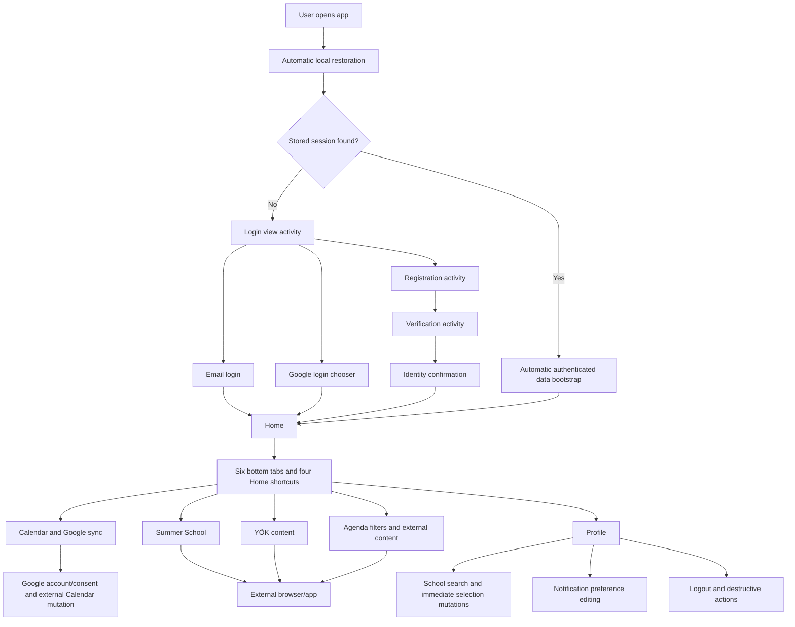

# Mobile Native In-App User Activity Report

Original report date: 27 July 2026\
Current-state refresh: 29 July 2026\
Target: `apps/mobile-native` Android release-candidate flow\
Source baseline: branch `agent/google-play-readiness-20260724`, commit `cbd0067`
Companion visual report: [`19-mobile-native-current-state-ui-ux-audit.md`](./19-mobile-native-current-state-ui-ux-audit.md)

> **PRE-PHASE-1 BASELINE NOTICE:** This report originated from commit `cbd0067` before Phase 1. The preserved historical `NAV-*`, `AUTH-*`, `VER-*`, and related rows describe that baseline, including its then-broken auth/session/storage behavior. The `CUR-*` closure addendum is a source-derived inventory for product planning, but [`mobile-native-redesign/phases/phase-01-auth-session-integrity.md`](./mobile-native-redesign/phases/phase-01-auth-session-integrity.md) and [`mobile-native-redesign/TEST_MATRIX.md`](./mobile-native-redesign/TEST_MATRIX.md) are authoritative wherever repaired Phase 1 implementation, tests, or native evidence conflict with this baseline. Phase 2 has not started.

## What “activity report” means today

The repository still contains **no product analytics SDK or first-party event sink**. None of the `CUR-*` activities below emits a page-view, tap, funnel, impression, duration, foreground/background, crash, or performance event. API logs, current database records, SecureStore values, and Google Calendar entries are operational side effects; they are not a complete, ordered in-app activity history. Consequently this report can state what a user *can do* and what data each action affects, but it cannot state how many users did it or when without new instrumentation.

Current static interaction inventory after password-recovery implementation: 6,126 lines in `App.tsx`, 56 `Pressable`, 15 `TextInput`, two `Switch`, and five `Alert.alert` declarations. Runtime lists create more individual controls than those lexical counts. Official Android Studio Stable, Emulator 36.6.11, WHPX, one Google APIs API 24 x86_64 image, and exactly one `AcademicPhase1Low` AVD now exist; current x86_64 debug assembly/install and visible MainActivity startup passed. Installed QA passed signed-out/in hydration, verification recovery/resend/error separation, verification-success→later-Login-failure, generic password recovery/visibility/Back/Cancel, reset/old-new Login and two-session revocation, manual-exam relaunch/two-account isolation, academic hierarchy replacement, logout late-settlement/relaunch, 360/320-dp reachability, and all six required 200%-font surfaces. Home navigation labels wrap/truncate and recovery password placeholders truncate at 2.0. TalkBack is unavailable with an exact blocker; the Windows host cannot run an iOS simulator.

Native execution results are tracked separately in the [Phase 1 native QA register](./mobile-native-redesign/evidence/phase-01-native/native-qa-results.md). An activity's presence in source or automated contract tests does not prove that its installed-app row passed.

### Current native activity execution disposition

| Activity group | Installed-app result | Exact limitation |
|---|---|---|
| `CUR-LIFE-01`, `CUR-LIFE-03`–`05`, `CUR-AUTO-01`–`04` | PASS for signed-out Login/no-Home flash, valid-session loading→Home/no-Login flash, verification restore, and expired-session cleanup | Hydration hard-error/retry injection was not run |
| `CUR-AUTH-06`, `CUR-AUTH-10`, `CUR-VER-01`–`05`, `CUR-VER-08` | PASS for Login/Register hide→show→hide, isolated registration, Verification, relaunch with blank code/no password, cooldown, resend, second relaunch, unverified-Login recovery, invalid-code handling, completion, and later stale-password Login failure | Server-expired verification submission is fixture-conditional and remains seeded automated evidence because the runtime has no time injection |
| `CUR-REC-01`–`03`, `CUR-REC-06`–`07`, `CUR-REC-10`–`16` | PASS for reachable known/unknown request presentation, six-digit entry, controlled invalid attempt, independent visibility, field mismatch/readiness, resend clearing, explicit Back/Cancel clearing, reset success, return to Login, old rejection, new-password Home, and two held-session revocations | Hardware Back is bound to the same tested cleanup helper; UI evidence does not claim JavaScript heap-byte erasure |
| `CUR-HOME-02`–`04`, `CUR-AUTO-04`–`07` | PASS for unique A exam add/relaunch, B isolation/add, and A-only return | Native storage-write failure/retry was not injected |
| `CUR-EDU-03`–`07`, `CUR-AUTO-09` | PASS for full A server/native restore, university replacement clearing descendants/class, and faculty replacement clearing department/class after relaunch | Broader academic-selector loading/error/no-results visual states remain frontend backlog |
| `CUR-ACC-01`, `CUR-AUTO-12` | PASS for content removal immediately, after five seconds, and after signed-out relaunch | Tombstone-write failure/retry remains automated-only |
| Navigation/layout use during these activities | PASS at 360 dp, 320 dp, and the full required six-surface 2.0 font set; hardware-keyboard Tab/focus/submit worked | At 2.0, Home nav labels wrap/truncate; TalkBack package/service is unavailable on the selected image |

This is a test-execution ledger, not telemetry. It does not change the central finding that the application produces no durable page-view or activity event stream.

## Exhaustive current in-app activity IDs

The current addendum contains **134 unique `CUR-*` rows** spanning lifecycle, Android/system Back, authentication, verification, password recovery, navigation, content, Google Calendar, academic selection, preferences, account actions, external handoff, and automatic/background behavior. No row is duplicated.

| Prefix | Activity family | Rows |
|---|---|---:|
| `CUR-LIFE` | App lifecycle and hydration | 8 |
| `CUR-OS` | Android/system Back behavior | 3 |
| `CUR-NAV` | Authenticated navigation and keyboard dismissal | 6 |
| `CUR-AUTH` | Login, registration, Google authentication, and auth recovery entry | 17 |
| `CUR-VER` | Email verification, resend, abandonment, and profile confirmation | 9 |
| `CUR-REC` | Password-recovery request, confirm, visibility, Back/cancel, resend, and reset | 16 |
| `CUR-HOME` | Home summaries, shortcuts, manual exams, and countdown reading | 7 |
| `CUR-CAL` | Calendar display and Google Calendar connection/sync | 10 |
| `CUR-SUM` | Summer School content and external handoff | 6 |
| `CUR-YOK` | YÖK announcements | 3 |
| `CUR-AGENDA` | Agenda view, filters, refresh, and content opening | 4 |
| `CUR-PRO` | Profile view | 1 |
| `CUR-EDU` | University/faculty/department selection | 8 |
| `CUR-PREF` | Notification preference editing and save | 6 |
| `CUR-ACC` | Logout, data deletion, account deletion, and cleanup retry | 10 |
| `CUR-EXT` | External browser/app handoff and return | 4 |
| `CUR-AUTO` | Automatic timers, loads, persistence, guards, and cleanup | 16 |
| **Total** |  | **134** |

Parameterized rows—such as “choose any one of six tabs” or “toggle one available category”—cover every runtime instance produced from that declaration. “Trace/effect” never means analytics.

### Lifecycle, operating-system, navigation, and keyboard activity

| Current ID | User activity | Immediate/current behavior | Trace or persistent effect |
|---|---|---|---|
| CUR-LIFE-01 | Open the app from a cold process | Blocking Hydration Loading appears; Login/Home cannot be used early | Local reads; possible device-ID write and stored-session refresh |
| CUR-LIFE-02 | Tap hydration `Tekrar Dene` | Re-runs device/session/owner restoration after a hard hydration error | Repeats controlled reads/requests; no analytics |
| CUR-LIFE-03 | Reopen with valid stored session | Refresh token is rotated and durably stored before owner bootstrap commits Home | Server refresh record + replacement `native_session` |
| CUR-LIFE-04 | Reopen without a session | Pending verification is restored if valid; otherwise Login commits | Local reads only |
| CUR-LIFE-05 | Reopen with expired/invalid/disabled session | Fail-closed session cleanup runs and Login becomes stable | Session tombstone/delete; server refresh attempt may be logged |
| CUR-LIFE-06 | Leave app in background and return | No `AppState`/foreground handler; retained React state resumes with no automatic refresh | No product event |
| CUR-LIFE-07 | Wait while a global message is visible | Message clears automatically after 3.5 seconds | Timer only |
| CUR-LIFE-08 | Wait on Verification | Expiry and resend countdown update every second | Timer only; pending record unchanged until resend/clear |
| CUR-OS-01 | Press Android Back on an app root/tab outside Password Recovery | There is no general route-stack/secondary-tab Back contract; Password Recovery is the only app-owned hardware-Back exception | No product event |
| CUR-OS-02 | Press Back/cancel in a native Google/browser/alert surface | That native surface owns cancellation/return; the app handles only the returned result it receives | Google/OS/browser may retain its own trace |
| CUR-OS-03 | Press Android Back in Password Recovery | Confirm → Request after clearing code/new-password secrets; Request → Login after clearing the recovery flow; busy state consumes Back without leaving | Memory cleanup only; no product event |
| CUR-NAV-01 | Tap any of six bottom tabs | Sets Home, Calendar, Summer, YÖK, Agenda, or Profile active | No persistence or analytics |
| CUR-NAV-02 | Tap the already-active tab | Reassigns the same state; no designed scroll-to-top | None |
| CUR-NAV-03 | Tap Home shortcut Calendar/Announcements/Summer/YÖK | Selects the mapped tab; Summer/YÖK can trigger first-load effects | Requests only when destination effect requires them |
| CUR-NAV-04 | Scroll any long view | Moves the one shared `ScrollView`; there is no per-tab offset contract | None |
| CUR-NAV-05 | Drag with keyboard visible | Dismisses keyboard (`interactive` on iOS, `on-drag` otherwise) | None |
| CUR-NAV-06 | Tap a handled control while keyboard is visible | Tap is retained by `keyboardShouldPersistTaps="handled"` | Control-specific effect |

### Login, registration, verification, and confirmation activity

| Current ID | User activity | Immediate/current behavior | Trace or persistent effect |
|---|---|---|---|
| CUR-AUTH-01 | Select Login mode | Shows email/password, verification recovery, email login, and Google entry | Memory only |
| CUR-AUTH-02 | Select Register mode | Shows full name/email/password and registration help; university list may prefetch | Public GET may occur; no analytics |
| CUR-AUTH-03 | Enter/edit full name | Updates registration draft | Memory only; trimmed value is sent only on registration |
| CUR-AUTH-04 | Enter/edit email | Updates shared auth draft; request use normalizes to lowercase/trimmed email | Memory only until request/pending record |
| CUR-AUTH-05 | Enter/edit password | Preserves exact raw string, including leading/trailing spaces | Memory only; never persisted |
| CUR-AUTH-06 | Tap show/hide password | Toggles masking in Login or Register with a labelled 48 × 48 control | None |
| CUR-AUTH-07 | Submit email login | Sends normalized email, exact password bytes, and device ID; controlled result activates an owner generation | Server session + durable session on success |
| CUR-AUTH-08 | Leave required login/register fields incomplete | The visible CTA stays disabled; the native “Eksik alan” alert is a defensive handler branch, not normally reachable by tapping the disabled CTA | None |
| CUR-AUTH-09 | Enter a registration password under 10 characters | The visible CTA stays disabled; the native “Şifre çok kısa” alert is a defensive handler branch | None |
| CUR-AUTH-10 | Submit valid registration | Creates user/verification request, opens Verification, persists only non-secret recovery metadata | Server user/verification + pending local record |
| CUR-AUTH-11 | Tap `E-postamı doğrula` | Opens Verification for normalized email, clears password/code, attempts to persist recovery metadata | Pending local record only |
| CUR-AUTH-12 | Receive unverified-email login result | Login error remains controlled and Verification recovery is opened automatically | Pending local record + failed server login trace |
| CUR-AUTH-13 | Start Google sign-in | Serializes SDK work, checks Play Services, clears cached choice, opens chooser | Google SDK interaction; no app analytics |
| CUR-AUTH-14 | Choose a Google account | Returns identity token, calls `/auth/google`, activates owner session on controlled success | Google interaction + backend user/session + local session |
| CUR-AUTH-15 | Cancel Google account chooser | Stops login and shows informational copy | Google/OS only |
| CUR-AUTH-16 | View auth when Google login is unconfigured | Google CTA is replaced by a configuration notice; email auth remains available | None |
| CUR-AUTH-17 | Encounter disabled/invalid Google account result | Queues SDK sign-out and shows controlled disabled/verification copy | Failed server request; Google sign-out attempt |
| CUR-VER-01 | Enter/edit verification code | Accepts at most four numeric-keyboard characters | Memory only; code is never persisted |
| CUR-VER-02 | Tap Verify with four characters | Calls `/auth/verify-email`; success clears pending record and opens Profile Confirmation | Consumes server verification; deletes pending local record |
| CUR-VER-03 | Tap resend while cooldown is active | Button is disabled; defensive handler also refuses and reports wait copy | No request |
| CUR-VER-04 | Tap resend when available | Calls `/auth/resend-verification-code`; updates expiry/cooldown; server 429 time is retained | Server verification mutation + pending local record |
| CUR-VER-05 | Relaunch into pending Verification | Restores email/expiry/cooldown but not password or code | Local read only |
| CUR-VER-06 | Tap `Giriş ekranına dön` | Returns to Login, clears password visibility/code/picker state | Pending recovery record remains until activation/verification clear |
| CUR-VER-07 | Confirm verified profile with retained registration password | Performs a separate login, then session activation/bootstrap | Server session + local session on success |
| CUR-VER-08 | Confirm verified profile without a password (restored flow) | Returns to Login with truthful “verified; enter password” copy | No server mutation |
| CUR-VER-09 | Receive login failure after successful verification | Returns to Login without relabelling the completed verification as failed | Failed login trace only |
| CUR-REC-01 | Tap `Şifremi unuttum` on Login | Clears Login password and any previous recovery secrets; opens Password Recovery Request | Memory only; no analytics |
| CUR-REC-02 | Enter/edit recovery email | Normalizes only when used; invalid syntax keeps request disabled and shows local guidance | Memory only; no analytics |
| CUR-REC-03 | Request a recovery code | Calls `/auth/password-recovery/request`; valid known and unknown addresses receive the same production status/body fields, but latency is not equalized | Server may create a digest-only recovery record. Body parity prevents direct response-field disclosure; timing-based account inference remains an open risk |
| CUR-REC-04 | Request with invalid email | Local validation blocks the request and displays fixed Turkish copy | No network/persistent effect |
| CUR-REC-05 | Wait during recovery request cooldown | One-second timer updates the 60-second resend label; request remains disabled | Timer only; recovery timing stays in memory |
| CUR-REC-06 | Enter/edit recovery code | Keeps only digits up to six characters; uses number-pad/one-time-code semantics | Memory only; never persisted |
| CUR-REC-07 | Enter/edit new password and confirmation | Preserves exact values; validates ten-character minimum and exact confirmation match | Memory only; never persisted |
| CUR-REC-08 | Toggle new-password visibility | Independently masks/unmasks the new-password field with a labelled 48 × 48 control | None |
| CUR-REC-09 | Toggle confirmation visibility | Independently masks/unmasks the confirmation field with a labelled 48 × 48 control | None |
| CUR-REC-10 | Submit invalid/mismatched recovery values | Fixed inline validation or controlled API error remains beside the active action | Failed request trace only when server is called; no raw payload shown |
| CUR-REC-11 | Submit a valid recovery confirmation | Calls `/auth/password-recovery/confirm`; conditionally consumes the code atomically, then sequentially replaces the password, revokes refresh sessions, and invalidates remaining recovery material | Those later repository operations are not one transaction; a failure after consumption can leave partial completion |
| CUR-REC-12 | Complete password reset successfully | Clears code/new password/confirmation/visibility state and returns to Login with truthful success copy | No recovery secret remains locally |
| CUR-REC-13 | Tap `Yeni Kod İste` | Repeats the generic request when cooldown permits, invalidates older accepted material, and updates expiry/cooldown | New digest-only server recovery record; older current record invalidated |
| CUR-REC-14 | Tap `Geri` or press Android hardware Back on Confirm | Clears code and both password fields, then returns to Recovery Request; hardware Back on Request cancels to Login | Memory cleanup only |
| CUR-REC-15 | Tap recovery Cancel | Clears all recovery/password state and returns to Login | Memory cleanup only |
| CUR-REC-16 | Attempt old password after reset, then new password | Uses normal Login path; old credentials are rejected and new credentials can create a new session | Failed old-password request then new refresh session on success |

### Home, content, and tab-specific activity

| Current ID | User activity | Immediate/current behavior | Trace or persistent effect |
|---|---|---|---|
| CUR-HOME-01 | View Home counts/cards | Reads current calendar/upcoming/Agenda/manual-exam memory | No impression event |
| CUR-HOME-02 | Enter manual exam title | Updates local draft | Memory only |
| CUR-HOME-03 | Enter manual exam date | Updates local draft; submit expects parseable `YYYY-MM-DD` | Memory only |
| CUR-HOME-04 | Add a valid manual exam | Appends owner-bound record, clears fields, reports success | Serialized owner-v2 local write |
| CUR-HOME-05 | Submit invalid/blank manual exam | Shows controlled top message | None |
| CUR-HOME-06 | Refresh Upcoming Events | Replaces loadable `/calendar/upcoming?limit=10` state | GET/infrastructure trace; backend may ingest calendar data |
| CUR-HOME-07 | Read a countdown/event card | No detail route; countdown changes only on component rerender | No impression event |
| CUR-CAL-01 | Refresh academic calendar | Loads `/calendar/my` into guarded loadable state | GET; backend may ingest/archive shared calendar data |
| CUR-CAL-02 | Tap Connect and Sync | Opens Google account selection if needed, asks Calendar Events scope, fetches sources, and syncs | Google OAuth + Google event mutations + owner-v2 summary |
| CUR-CAL-03 | Choose an account in Calendar flow | Supplies account/token to the sync | Google SDK trace |
| CUR-CAL-04 | Grant Calendar consent | Adds `calendar.events` scope and continues | Google OAuth grant |
| CUR-CAL-05 | Deny/cancel Calendar consent or chooser | Stops before summary commit and shows dedicated error | Google-only consent trace possible |
| CUR-CAL-06 | Tap Sync Now | Uses the expected connected account, fetches two sources, creates/updates/deletes/verifies managed events | Google events + updated owner-v2 summary |
| CUR-CAL-07 | Tap Change Google Account | First removes the old local summary, then forces account selection and sync | Old remote account events remain; new Google/local effects may occur |
| CUR-CAL-08 | Encounter cached-account mismatch | Clears local summary, queues sign-out, requires explicit reselection | Local summary delete + Google sign-out attempt |
| CUR-CAL-09 | Logout, delete, expire, or switch account while Google work is active | Account invalidation aborts source/direct REST work and suppresses stale completion; an already-open native chooser/consent sheet cannot itself be dismissed by JS | Partial remote mutation remains theoretically possible |
| CUR-CAL-10 | Read Academic Dates | Displays at most eight qualifying events; no detail/show-all action | No impression event |
| CUR-SUM-01 | Enter Summer tab first time with university | Automatically loads `/calendar/summer-school/my` | GET/backend content-pipeline effects possible |
| CUR-SUM-02 | Refresh Summer School | Repeats the Summer payload GET | GET only from app perspective |
| CUR-SUM-03 | Tap linked requirement | Runs shared external-link handoff | Browser/app trace outside product analytics |
| CUR-SUM-04 | Tap unlinked requirement | Pressable has no link work; no visible response | None |
| CUR-SUM-05 | Tap linked own/same-department announcement or university option | Opens external destination | Browser/app trace |
| CUR-SUM-06 | Tap unlinked same-department option | No handler work/visible response | None |
| CUR-YOK-01 | Enter YÖK first time | Automatically loads `/announcements/yok?limit=30` | GET; backend can upsert/fetch/cache source items |
| CUR-YOK-02 | Refresh YÖK | Repeats the YÖK GET | GET/backend pipeline trace |
| CUR-YOK-03 | Tap linked YÖK card | Opens external destination | Browser/app trace |
| CUR-AGENDA-01 | View Agenda | Reads up to 60 current items grouped by type/scope | No impression event |
| CUR-AGENDA-02 | Select All/Announcements/News/Events filter | Updates local filter and derived groups/counts | Memory only; filter not persisted |
| CUR-AGENDA-03 | Refresh Sources | Loads `/announcements/my?limit=60` | GET; backend can discover/crawl/replace/cache sources |
| CUR-AGENDA-04 | Tap a linked content card | Opens external destination | Browser/app trace |

### Profile, academic selection, preferences, and destructive activity

| Current ID | User activity | Immediate/current behavior | Trace or persistent effect |
|---|---|---|---|
| CUR-PRO-01 | View Profile | Reads current identity, academic draft, preferences, and account actions | No page-view event |
| CUR-EDU-01 | Expand/collapse School Information | Toggles inline editor; can load universities | Public university GET possible |
| CUR-EDU-02 | Refresh universities | Loads up to 500 universities | Public GET |
| CUR-EDU-03 | Open/close university, faculty, or department picker | Toggles one picker; child picker requires its parent | Memory only; parent change can trigger list GET |
| CUR-EDU-04 | Type university/faculty/department search | Filters the already-loaded list locally | Query remains local |
| CUR-EDU-05 | Select university | PATCHes full replacement with university only; clears faculty, department, and class level; refreshes dependent content | Server profile mutation + follow-up GETs |
| CUR-EDU-06 | Select faculty | PATCHes university+faculty; clears department and class level; refreshes Agenda | Server profile mutation + follow-up GET |
| CUR-EDU-07 | Select department | PATCHes university+faculty+department and omits/clears class level | Server profile mutation + follow-up GET |
| CUR-EDU-08 | Attempt academic action while global/selection cleanup is busy | Selectors/actions are disabled or handler refuses; no competing profile mutation starts | None |
| CUR-PREF-01 | Toggle master reminders | Changes local draft only | None until Save |
| CUR-PREF-02 | Select All Important Dates | Enables all available categories and collapses category list | Memory only |
| CUR-PREF-03 | Select “I’ll choose” | Switches mode and expands categories | Memory only |
| CUR-PREF-04 | Expand/collapse category list | Toggles inline panel | Memory only |
| CUR-PREF-05 | Toggle any available category | Changes one local category draft | Memory only |
| CUR-PREF-06 | Save Notification Preferences | PATCHes enabled/categories plus retained/default rules and quiet hours | Current preference record; no push-token registration |
| CUR-ACC-01 | Tap Logout | Starts fail-closed session tombstone before visible sign-out, then clears in-memory state, pending verification, Google summary/SDK choice, and attempts server cleanup; the owner-v2 manual-exam key is retained for that owner's next login | Session/storage deletes + server revocation if reached |
| CUR-ACC-02 | Logout session-storage write fails | Account stays visibly signed in and an error/retry state appears | Old session remains; failure is visible, not analytics |
| CUR-ACC-03 | Tap Delete My Data | Opens destructive native alert | None |
| CUR-ACC-04 | Cancel Delete My Data | Closes alert, no mutation | None |
| CUR-ACC-05 | Confirm Delete My Data | Waits for tracked mutations, deletes server data, invalidates stale work, resets account-owned state, and deletes pending verification plus owner local records | Server deletion + owner local deletes; account stays active |
| CUR-ACC-06 | Tap Delete Account | Opens irreversible native alert | None |
| CUR-ACC-07 | Cancel Delete Account | Closes alert, no mutation | None |
| CUR-ACC-08 | Confirm Delete Account | Tombstones local session first, then deletes pending verification/owner local state and requests server deletion without auth refresh | Local deletes + server deletion/anonymization and password-recovery-material cleanup if reached |
| CUR-ACC-09 | Tap `Temizliği Tekrar Dene` | Retries only controlled unresolved local targets for the matching owner/action | Local write/delete/sign-out attempt; no analytics |
| CUR-ACC-10 | Destructive action server result is uncertain | Shows whether local closure succeeded but server session/account could not be confirmed | Operational state only; backend has no recent-auth challenge |

### External browser/app activity

| Current ID | User activity | Immediate/current behavior | Trace or persistent effect |
|---|---|---|---|
| CUR-EXT-01 | Tap any linked Agenda/YÖK/Summer card | Calls `Linking.canOpenURL`, then `Linking.openURL` if supported | Destination/browser history and access logs may exist |
| CUR-EXT-02 | Choose/cancel an OS browser/app chooser or destination consent prompt | OS-owned handoff; app has no in-app browser or consent state | OS/destination only |
| CUR-EXT-03 | Return from browser/app, including with Android Back | Existing component/tab/scroll state resumes as the OS returns it; no explicit return callback or refresh | No product event |
| CUR-EXT-04 | Tap unsupported link | Shows controlled “cannot open” message | No destination request |

## Current automatic and reactive activity IDs

| Current ID | Trigger | Automatic effect | User-visible consequence / trace |
|---|---|---|---|
| CUR-AUTO-01 | Cold launch | Restore/create `native_device_id` before session work | No standalone UI beyond hydration |
| CUR-AUTO-02 | Stored valid session | Rotate refresh token, validate owner/status, serialize replacement session | Hydration remains blocking until resolved |
| CUR-AUTO-03 | Signed-out launch | Parse pending verification; delete malformed record | Verification resumes or Login appears |
| CUR-AUTO-04 | Authenticated activation/launch | Restore owner-v2 manual exams and Google summary; reject owner mismatch | Home/Calendar owner state appears only after checks |
| CUR-AUTO-05 | Legacy manual-exam key exists | Discard it because the record has no trusted owner proof; delete legacy key | Informational safety message |
| CUR-AUTO-06 | Legacy Google summary exists | Migrate only a structurally valid matching-owner record to v2; otherwise delete | Connected summary may appear only for matching owner |
| CUR-AUTO-07 | Manual-exam state changes after owner hydration | Serialize entire owner envelope through storage queue | Silent unless write fails; then cleanup issue |
| CUR-AUTO-08 | Preferences load/update | Rebuild category draft and infer All vs Selected mode | Controls update; no telemetry |
| CUR-AUTO-09 | University/faculty selection changes | Load child faculties/departments | Spinner/error state where rendered; public GET |
| CUR-AUTO-10 | First YÖK/Summer entry | Load content once per current in-memory empty state | Destination spinner/content/error |
| CUR-AUTO-11 | Authenticated request gets eligible 401 | Coalesce one refresh-token exchange, rotate session, retry once | Silent success or controlled session cleanup |
| CUR-AUTO-12 | Logout/deletion/session expiry/account switch | Increment owner generation, abort tracked requests, suppress stale results, and include pending verification in observable cleanup | Prior-account data cannot repopulate current UI |
| CUR-AUTO-13 | Cleanup starts while authenticated PATCHes exist | New tracked mutations are blocked; Delete My Data waits for active ones to settle | Busy state; bounded by request timeouts |
| CUR-AUTO-14 | Google SDK operation starts | Serialize chooser/scope/sign-out operations | Prevents overlapping SDK calls; native sheet still cannot be programmatically dismissed |
| CUR-AUTO-15 | Any API request exceeds default budget | Default 15-second timeout aborts request/body consumption unless a narrower operation timeout applies | Controlled failure copy/loading exit |
| CUR-AUTO-16 | Password Recovery Request/Confirm is active | Update expiry and resend countdown every second while an in-memory recovery record exists | Timing labels/disabled resend update; no persistent secret or analytics event |

## Current storage and side-effect ledger

### Local device storage

| Key/prefix | Current data | Write/delete activities | Ownership, ordering, and failure behavior |
|---|---|---|---|
| `native_session` | Access/refresh tokens, expiry, validated user identity | Session activation/rotation; logout, expiry, account deletion | Native SecureStore; writes serialize. Logout/account deletion overwrite with non-secret `native_session_invalidated_v1`, then invalidate the owner through the durable-write callback, then best-effort delete. Expiry invalidates in-flight work first, then tombstones; a write failure clears memory into the blocking hydration-error state. All tombstone failures are visible and fail-closed. |
| `native_device_id` | Random local device identifier | First launch only | Install scoped, reused for app accounts, attached to backend refresh sessions; not cleared by user-data deletion |
| `native_pending_email_verification` | Normalized email, `verificationExpiresAt`, optional `resendAvailableAt` | Register, recovery, resend; clear on verification/session activation, logout, session expiry, Delete My Data, and Delete Account | Contains no password, code, access token, or refresh token. Writes serialize. Parse/storage/delete failures become a controlled retryable cleanup target. |
| No password-recovery storage key | Recovery email/timing record, six-digit code, new password, confirmation, and visibility flags exist only in React memory | Open/request/confirm/resend/Back/cancel/success | Nothing is written to SecureStore/localStorage. Back/success/cancel clear secrets; process death discards the flow instead of restoring recovery material. |
| `native_manual_exams_v2_<encoded-owner>` | Schema v2, explicit `ownerId`, exam IDs/titles/dates, `updatedAt` | Owner restore/add; data/account deletion | Envelope owner must match. Writes wait for hydration and serialize; malformed/mismatched values are deleted; write failure is retryable. |
| `native_manual_exams` (legacy) | Old global exam array, if present | Startup migration check | Current app supplies no separate ownership proof, so legacy values are discarded and key deleted rather than assigned to the signed-in account. |
| `native_google_calendar_connection_v2_<encoded-owner>` | Owner ID, Google email, last-sync time, result counts, warnings | Successful sync; account change; logout/data/account deletion | Structurally and owner validated. Account-email drift clears the summary and queues SDK sign-out. Local cleanup failure is visible/retryable. |
| `native_google_calendar_connection` (legacy) | Old global summary, if present | Startup restore/migration | Migrates only when its embedded owner matches the active owner and required fields are valid; legacy key is then deleted. Otherwise it is deleted. |

All of these use browser `localStorage` only on the diagnostic web target; native builds use SecureStore. The storage queue prevents a late live-session write from overtaking a logout/account-deletion tombstone. A cleanup issue records only controlled target identifiers, not secrets.

### Backend and external side effects

| Trigger | Durable/remote effect | Important limitation |
|---|---|---|
| Register/verify/login/refresh/logout | User, verification, and refresh-session records | Operational records do not reconstruct page/tap history |
| Password-recovery request/confirm | Digest-only expiring recovery record, sender attempt, password-hash replacement, code consumption, and refresh-session revocation | Generic production status/body fields prevent direct response-field enumeration, but latency is not equalized. Confirm atomically consumes only the code; later password/session/invalidation writes are sequential. Records still do not reconstruct the native funnel |
| Academic selection | Full replacement profile mutation; invalid parent-child pairs rejected | Native has no class-level selector. Because all three selection payloads omit `classLevel`, any existing class level is cleared rather than fabricated as `2`. |
| Preference GET/PATCH | GET can create defaults; PATCH stores current preference document | Native never requests OS notification permission or calls `/devices/register` |
| Calendar/content GETs | Can ingest, archive, discover, crawl, upsert, cache, or update source health | These shared pipeline writes do not prove a card was viewed |
| Delete My Data / Account | Deletes/anonymizes backend-owned data as endpoint defines | No recent-password/reauthentication challenge exists yet |
| Google account/Calendar | OAuth grant; app-managed event create/update/delete/verify; Google/browser logs | Abort signals cover source/direct REST work, but cannot dismiss an already-open native chooser/consent sheet. Logout/deletion does not revoke OAuth or remove already-created remote events; a request already accepted by Google can leave a partial mutation. |
| External link | Browser/app history and destination access logs | No app callback proves the user read content or returned |

## Superseded baseline mapping

| Historical rows/claims | Current authoritative replacement |
|---|---|
| Baseline launch sequence and `App starting` row | `CUR-LIFE-01`–`CUR-LIFE-06`, `CUR-AUTO-01`–`CUR-AUTO-04` |
| `AUTH-01`–`AUTH-12` | `CUR-AUTH-01`–`CUR-AUTH-17`; auth modes are locked during auth, passwords preserve raw bytes, and visibility/recovery now exist |
| `VER-01`–`VER-06` | `CUR-VER-01`–`CUR-VER-09`; correct resend, persisted timing, resumed verification, and separate verify/login replace the old behavior |
| Baseline “Forgot/reset password does not exist” claim | `CUR-REC-01`–`CUR-REC-16`; complete request/confirm/resend/Back/cancel/success activity exists in source. Installed known/unknown presentation, invalid/visibility/Back/Cancel/reset/old-new flow and same-runtime two-session revocation pass |
| `HOME-04` and legacy manual-exam risk | `CUR-HOME-04`, `CUR-AUTO-05`, and the v2/legacy storage rows |
| `CAL-02`–`CAL-06` stale-owner risk | `CUR-CAL-02`–`CUR-CAL-09`; source/REST cancellation, generation checks, SDK serialization, and email mismatch handling are current |
| `PRO-01`–`PRO-07` cleanup ordering | `CUR-ACC-01`–`CUR-ACC-10`; tombstone-first fail-closed behavior and visible cleanup retry are current |
| `EDU-05`, `EDU-08`, `EDU-11` partial updates / hard-coded `classLevel:2` | `CUR-EDU-05`–`CUR-EDU-08`; full replacement clears descendants and omitted class level |
| Baseline local-storage ledger | Current local device storage table above |
| Baseline claim of no cancellation/generation guard | `CUR-AUTO-11`–`CUR-AUTO-14`; account-owned requests are guarded/aborted, with the native Google-sheet limitation stated explicitly |

No page-view, tap, or activity event was added in Phase 1. Sections 9–13 later in this file are still only a proposed privacy-safe instrumentation design. The Section 9 page-view resolver, 14 controlled current `screen_name` values, deduplication rules, and recovery events have been refreshed for the Phase 1 screen set; they remain unimplemented.

---

## Historical pre-Phase-1 baseline — 1. Purpose and interpretation

> Historical evidence only. “Current” in the preserved text below means the 27 July `cbd0067` snapshot. Use the `CUR-*` register and current ledgers above for implementation or analytics planning.

This report catalogs **all activity the current native client allows or automatically performs**:

- Screen/view entry and navigation.
- Taps, text entry, switches, filters, confirmations, and cancellation.
- API reads and mutations caused by those activities.
- Secure local-storage changes.
- Google account, Google Calendar, and external-browser handoffs.
- Visible feedback and state transitions.
- Activities that are currently measurable versus activities that leave no product-analytics trace.

This is an **as-built activity inventory**, not a historical usage report. The native app currently has no analytics SDK, page-view tracking, event tracking, session-duration tracking, crash reporting, or interaction telemetry. Therefore the repository cannot currently answer how many users performed these activities, how often they did so, or where they abandoned a flow.

## Historical pre-Phase-1 baseline — 2. Executive summary

The client presents four unauthenticated account stages and six authenticated tabs. User actions are implemented through one 4,224-line component containing 42 `Pressable` declarations, 11 `TextInput` declarations, two `Switch` declarations—one of which expands to every notification category—and four native `Alert` declarations. Dynamic cards, selector options, filter items, and bottom tabs expand those source declarations into many runtime controls.

The most consequential activity findings are:

1. **Nearly all product-consumption activity is invisible.** Screen views, tab use, scrolling, filters, refreshes, content impressions, link opens, manual exam use, and Google Calendar outcomes produce no analytics event.
2. **“Resend code” is an available activity that cannot succeed.** It submits registration again instead of calling the resend endpoint.
3. **Verification creates a real server session before the user confirms the profile.** Editing details or closing the app discards the only client reference without revoking that refresh token.
4. **“Enable notifications” is incomplete activity.** It changes preference JSON but never requests OS notification permission or registers a push token/device.
5. **Local and asynchronous activity is not safely account-scoped.** Manual exams, academic fields, cached content, and Google state can survive logout/session expiry; requests already in flight can later repopulate the prior account's data or persist its session/Google summary.
6. **Changing a school parent can leave stale children on the server.** The UI clears faculty/department locally, but omitted child IDs are not cleared by current repository updates, so the next profile load can restore a mixed hierarchy.
7. **Several activities have hidden or misleading feedback.** Global results appear at the top of scroll content for 3.5 seconds; invalid credentials and verification codes are described as session expiry; preference loading errors are invisible. Registration also advertises eight password characters while the API requires ten.
8. **Google Calendar activity mutates external user data.** It creates, updates, verifies, and deletes app-managed entries in the selected Google account, but there is no disconnect/revoke/remove-old-account activity.
9. **Some apparent reads perform backend writes.** Preferences can be created on first GET, while calendar and announcement reads can ingest, archive, upsert, crawl, and cache shared records.
10. **Only indirect operational traces exist.** Some server mutations, refresh-token records, verification records, profile changes, preference records, local SecureStore values, and Google events can show that something happened. They do not form a complete or reliable user-activity timeline.

## Historical pre-Phase-1 baseline — 3. Activity availability by user state

| User/application state | Available activity |
|---|---|
| App starting | Login UI appears immediately while restoration runs; user may begin auth activity before hydration completes |
| Signed out | Switch Login/Register, enter identity fields, email login, Google login, register |
| Registration created but not verified | Enter/submit code, attempt resend, return to registration details |
| Verified with pending session | Review identity, confirm/start, return to registration form |
| Authenticated without university | All six tabs remain available; Calendar/Home data are limited; Summer/Agenda show school guidance; user can set school in Profile |
| University selected | Calendar/upcoming/Agenda/Summer activities become meaningful; faculty picker is enabled |
| Faculty selected | Department picker is enabled; scoped Agenda activity can update |
| Department selected | Same-department Summer School activity can return relevant options |
| Google account authorized | Sync Now and Change Google Account are available; local UI shows connected metadata |
| Notification preferences loaded or defaulted | Master/mode/category edits and save are available; actual device delivery is still not registered |
| Network unavailable | Local tab/filter/manual-input activity remains; most remote actions fail; no explicit offline mode exists |

## Historical pre-Phase-1 baseline — 4. End-to-end activity flow



## Historical pre-Phase-1 baseline — 5. User-triggered activity inventory

Activity IDs are stable references for frontend work and future analytics mapping. “Recorded now” describes explicit product data/telemetry, not incidental infrastructure access logs.

### 5.1 Global navigation and interaction

| ID | User activity | Preconditions | Immediate client effect | Remote/persistent effect | Feedback now | Recorded now |
|---|---|---|---|---|---|---|
| NAV-01 | Tap one of six bottom tabs | Authenticated | Sets `activeTab` to Home, Calendar, Summer, YÖK, Agenda, or Profile | None | Active color/icon changes | No |
| NAV-02 | Tap the already-active tab | Authenticated | Reassigns same state | None | No scroll-to-top or other response | No |
| NAV-03 | Tap Home shortcut: Calendar | Home visible | Opens Calendar tab | None | Destination content appears | No |
| NAV-04 | Tap Home shortcut: Announcements | Home visible | Opens Agenda tab | None | Destination content appears | No |
| NAV-05 | Tap Home shortcut: Summer School | Home visible | Opens Summer tab | May trigger first Summer load on entry | Destination content/spinner appears | No |
| NAV-06 | Tap Home shortcut: YÖK | Home visible | Opens YÖK tab | May trigger first YÖK load on entry | Destination content/spinner appears | No |
| NAV-07 | Scroll a view | Any long view | Changes the one shared `ScrollView` offset | None | Native scroll behavior | No |
| NAV-08 | Drag to dismiss keyboard | Keyboard visible | Keyboard dismisses (`interactive` iOS; `on-drag` otherwise) | None | Native keyboard animation | No |
| NAV-09 | Tap another control while keyboard is open | Input active | Tap is retained by `keyboardShouldPersistTaps="handled"` | Depends on control | Control-specific | No |

Source: `App.tsx:1952–1960`, `2240–2260`, `2991–3019`.

The same `ScrollView` stays mounted across tabs. Tab selection does not explicitly reset scroll position or preserve a separate offset per tab, so the apparent landing position requires runtime confirmation.

### 5.2 Login and registration activity

| ID | User activity | Input/preconditions | Client and network behavior | Success transition | Failure/cancel behavior | Recorded now |
|---|---|---|---|---|---|---|
| AUTH-01 | Select Login mode | Signed out | Sets `authMode=login`; registration effect resets stage/pickers/token | Login form | No explicit message | No |
| AUTH-02 | Select Register mode | Signed out | Sets `authMode=register`; may load universities even though registration no longer uses them | Registration form | University load failure is not relevant to visible registration | No |
| AUTH-03 | Enter full name | Register mode | Updates in-memory `fullName` each keystroke | Enables submit when all three identity fields are non-empty | No inline validation | No |
| AUTH-04 | Enter email | Login/Register | Updates shared in-memory `email` each keystroke | Enables submit with password | No inline validation | No |
| AUTH-05 | Enter password | Login/Register | Updates shared in-memory `password`; field masks text; registration placeholder recommends at least 8 characters while API validation requires 10 | Enables submit with required companion fields | No visibility toggle/strength feedback; 8–9 characters pass client readiness but fail server validation | No |
| AUTH-06 | Submit email login | Non-empty email/password and device ID | `POST /auth/login` with normalized email, trimmed password, device ID | Persists session, opens Home, bootstraps account data | All 401s say session may have expired; generic global banner | Server refresh-token/session record; no analytics |
| AUTH-07 | Tap login before device ID exists | UI can be reached before hydration | No API call | None | Native “Hazırlanıyor” alert | No |
| AUTH-08 | Submit registration | Non-empty name/email/password; client enforces no length rule | `POST /auth/register`; password is also sent as confirmation; API enforces a 10-character minimum | Opens Verification and may prefill development preview code | API error in global banner, including the client/server password-contract mismatch | User and verification records; no analytics |
| AUTH-09 | Start Google login | Google configured, device ID ready | Checks Play Services, signs out cached choice, opens native chooser, obtains ID token, calls `POST /auth/google` | Persists session, opens Home, bootstraps data | Cancel/info; Play Services/config/API errors in banner | Google account interaction + server session; no analytics |
| AUTH-10 | Choose Google account | Native chooser open | Returns Google identity/token to app | Continues Google login | Cancellation returns informational banner | Google/OS only; no app analytics |
| AUTH-11 | Cancel Google chooser | Native chooser open | Stops login | Remains signed out | “Google girişi ... kapatıldı” banner | No |
| AUTH-12 | Switch auth mode during a request | Mode toggles remain enabled | Can change visible form/state while network action is active | Depends on request completion | Potential confusing late result | No |

Source: `App.tsx:807–808`, `885–899`, `1090–1235`, `1974–2133`; API password rule at `auth.dto.ts:3–15`.

Sensitive values involved: full name, email, password, Google ID token, device ID, access token, and refresh token. None should ever be copied into analytics properties.

### 5.3 Email verification and identity confirmation

| ID | User activity | Input/preconditions | Client and network behavior | Success transition | Failure/cancel behavior | Recorded now |
|---|---|---|---|---|---|---|
| VER-01 | Enter verification code | Verification stage | Updates in-memory free-form token | Enables conceptual completion, although button is not disabled when blank | Blank submit gives global error | No |
| VER-02 | Complete verification | Non-empty code and device ID | `POST /auth/verify-email`, then separately `POST /auth/login` in same `try` block; verification consumes the code and activates the account, while login creates a real refresh session | Stores that session only in `pendingVerifiedSession` and opens Profile Confirmation | Invalid code becomes “session expired”; login failure is reported as verification failure | Verification-token consumption and refresh-session record; no analytics |
| VER-03 | Resend code | Registration fields still in memory | **Incorrectly repeats `POST /auth/register`** | In practice cannot resend for existing email | Existing-email conflict; recovery blocked | Failed server request only; no analytics |
| VER-04 | Edit registration details from Verification | Not busy | Sets Register/Auth stage; clears pending session, picker, and code | Registration form | Same email now conflicts if submitted again; if verification/login already succeeded, the server refresh token is not revoked | No client activity event; orphan session can remain server-side |
| VER-05 | Confirm Profile and Start | Pending verified session exists | Persists pending session and bootstraps authenticated context | Home | If pending session missing, returns to Verification | Session record already exists; no analytics |
| VER-06 | Edit details from Profile Confirmation | Not busy | Same reset as VER-04 and drops the only client-held session reference | Registration form | Can strand the verified account until Login is discovered and leaves the created refresh token valid until expiry/revocation | No client activity event; server session remains |

Source: `App.tsx:1237–1356`, `2136–2207`; backend resend route at `auth.controller.ts:21–23`; verification/session behavior at `auth-application.service.ts:49–58`, `178–189`.

### 5.4 Home and manual-exam activity

| ID | User activity | Preconditions | Client behavior | Persistent/remote effect | Feedback now | Recorded now |
|---|---|---|---|---|---|---|
| HOME-01 | View Home counts/cards | Authenticated | Reads in-memory calendar, upcoming, agenda, and manual-exam state | None | Counts/cards, often zero during load | No impression/page view |
| HOME-02 | Enter manual exam title | Home | Updates `manualExamTitle` each keystroke | None until submit | Platform input | No |
| HOME-03 | Enter manual exam date | Home | Updates raw date string each keystroke | None until submit | Placeholder requests `YYYY-MM-DD` | No |
| HOME-04 | Add manual exam | Non-empty title/date; JavaScript can parse date | Creates local ID, trims title, converts parsed date to ISO, appends state | Entire manual-exam array written to `native_manual_exams` SecureStore/localStorage | Global success; validation error at top of scroll | Local storage only; no analytics/server record |
| HOME-05 | Read exam countdown | Exam data present | Calculates countdown only when component renders | None | Text can become stale while screen remains open | No impression |
| HOME-06 | Refresh Upcoming Events | Authenticated; not already loading/global busy | `GET /calendar/upcoming?limit=10`; replaces prior loadable state | Memory only | Spinner or inline error | GET may appear in infrastructure logs; no product event |

Source: `App.tsx:688–710`, `825–827`, `1666–1678`, `1928–1950`, `2209–2343`.

Manual exams have no edit/delete activity and are not sent to the backend or Google Calendar. The storage key is global rather than user-specific, and initial empty-state persistence can race restoration.

### 5.5 Calendar and Google Calendar activity

| ID | User activity | Preconditions | Client/network/external behavior | Success effect | Failure/cancel behavior | Recorded now |
|---|---|---|---|---|---|---|
| CAL-01 | Refresh academic calendar | Authenticated | `GET /calendar/my` | Replaces calendar state | Spinner/error; duplicate taps are possible because disabled state checks global busy, not `calendar.loading` | GET only; no analytics |
| CAL-02 | Connect and Sync | Authenticated; no local connection summary | Opens Google account/consent flow; requests `calendar.events`; fetches calendar and up to 100 agenda records; runs direct Google sync | Creates/updates/deletes/verifies managed events; stores account email/counts/time/warnings locally | Dedicated sync error or cancellation copy | Google events + local summary; no analytics |
| CAL-03 | Grant Calendar scope | Native Google consent shown | Google adds Calendar Events scope and returns access token | Sync continues | Cancellation stops sync | Google only; no analytics |
| CAL-04 | Deny/cancel Calendar scope | Consent shown | No Calendar mutation | Remains disconnected/historically connected | Dedicated error copy | No app analytics |
| CAL-05 | Sync Now | Local connection metadata exists | Uses current Google account unless account selection is needed; performs same source fetch and sync | Updates Google events and local counts/time | Partial-source warnings or sync error; after session-expiry cleanup, stale Google identity/summary can be reused by a later app account | Google + local summary; no analytics |
| CAL-06 | Change Google Account | Connected metadata exists | Signs out cached selection, opens chooser, then syncs selected account | Stores new account summary; mutates new account | Old account’s managed events are not cleaned up | Google + local summary; no analytics |
| CAL-07 | Read Academic Dates | Calendar data present | Displays first eight qualifying university events | None | No event-detail or show-all action | No impression |

Source: `App.tsx:938–960`, `1666–1671`, `1717–1835`, `2345–2486`; direct sync in `src/google-calendar/google-calendar-sync.ts`.

Google access tokens are not persisted by this code. The locally persisted connection record contains owner ID, Google account email, last-sync time, mutation/verification counts, and warnings. Managed event content and private metadata are stored in the selected Google account.

The operation captures the app session at start but has no cancellation or owner-generation check. Logout, data deletion, account deletion, and tab navigation remain possible while Google sync is busy. A late completion can therefore continue remote writes and re-persist the old app user's connection summary after local cleanup.

### 5.6 Summer School activity

| ID | User activity | Preconditions | Effect | Feedback | Recorded now |
|---|---|---|---|---|---|
| SUM-01 | Enter Summer School tab | Authenticated | If university exists and no prior Summer payload, automatically loads `/calendar/summer-school/my` | Spinner/content/empty/error | No page-view event |
| SUM-02 | Refresh Summer School | University selected; not loading/busy | `GET /calendar/summer-school/my` | Spinner/error/content | GET only; no product event |
| SUM-03 | Tap requirement with source URL | URL exists | Checks support and opens external browser/app | External handoff; unsupported-link banner | No click event |
| SUM-04 | Tap requirement without source URL | Card is still styled as pressable | No handler work | No visible response | No |
| SUM-05 | Tap own/same-department announcement | Link supplied | Opens external browser/app | External handoff/error | No click event |
| SUM-06 | Tap same-department university option with URL | Source URL exists | Opens external browser/app | External handoff/error | No click event |
| SUM-07 | Tap same-department option without URL | Card looks pressable | No handler work | No response | No |

Source: `App.tsx:873–883`, `1697–1708`, `1902–1925`, `2488–2603`.

The refresh does not refresh the Summer School Dates section because those dates are derived from separate `calendar.data.events`.

### 5.7 YÖK content activity

| ID | User activity | Preconditions | Effect | Feedback | Recorded now |
|---|---|---|---|---|---|
| YOK-01 | Enter YÖK tab first time | Authenticated; no current YÖK data | Automatically `GET /announcements/yok?limit=30` | Spinner/content/error/empty | No page-view event |
| YOK-02 | Refresh YÖK | Not loading/busy | Repeats public GET | Spinner/content/error | GET only; no product event |
| YOK-03 | Tap YÖK content card | Link supplied | Checks URL support and opens external browser/app | Handoff or unsupported-link banner | No click event |

Source: `App.tsx:873–883`, `1693–1695`, `1902–1925`, `2605–2639`.

### 5.8 Agenda activity

| ID | User activity | Preconditions | Client/network effect | Feedback | Recorded now |
|---|---|---|---|---|---|
| AG-01 | View Agenda | Authenticated | Reads up to 60 in-memory items grouped by content type and scope | Count, groups, or contextual empty | No page-view/impression event |
| AG-02 | Select All filter | Agenda visible | Sets local filter `all`; recomputes groups/counts | Active pill changes | No |
| AG-03 | Select Announcements filter | Agenda visible | Sets local filter `announcement` | Active pill/content changes | No |
| AG-04 | Select News filter | Agenda visible | Sets local filter `news` | Active pill/content changes | No |
| AG-05 | Select Events filter | Agenda visible | Sets local filter `event` | Active pill/content changes | No |
| AG-06 | Refresh Sources | University selected; not loading/busy | `GET /announcements/my?limit=60` | Spinner/content/error | GET only; no product event |
| AG-07 | Tap content card | Link supplied | Checks support and opens external browser/app | External handoff/error | No click event |

Source: `App.tsx:485–540`, `1680–1691`, `1902–1925`, `2641–2725`.

Filter choice is not persisted. Leaving and re-entering keeps it only while the component instance remains mounted; relaunch resets it to All.

### 5.9 Profile account activity

| ID | User activity | Preconditions | Network/local/external effect | Success transition | Failure/cancel behavior | Recorded now |
|---|---|---|---|---|---|---|
| PRO-01 | Logout | Authenticated | Attempts `POST /auth/logout`; regardless of network result, clears part of client state, stored session, Google summary, and Google cached sign-in | Login with informational banner | Network/expired-token failure is deliberately hidden; manual exams, identity/school drafts and some caches remain; in-flight refresh/content/Google work is not cancelled | Token revocation record only if server reached; no analytics |
| PRO-02 | Tap Delete My Data | Authenticated | Opens native destructive alert | Await choice | Cancel closes alert | No |
| PRO-03 | Cancel Delete My Data | Alert open | No mutation | Returns Profile | None | No |
| PRO-04 | Confirm Delete My Data | Alert open | `DELETE /me/data`; resets selected local state; deletes local Google summary/manual-exam key | Remains authenticated; global success | Global error; expired token may refresh through normal request path | Server deletion mutation; no analytics |
| PRO-05 | Tap Delete Account | Authenticated | Opens native irreversible alert | Await choice | Cancel closes alert | No |
| PRO-06 | Cancel Delete Account | Alert open | No mutation | Returns Profile | None | No |
| PRO-07 | Confirm Delete Account | Alert open | `DELETE /me` with `deleteData:true`, no auth refresh; clears session/account state; signs out Google | Login with success banner | Expired access token causes failure; no reauthentication | Server deletion/anonymization mutation; no analytics |

Source: `App.tsx:1358–1508`, `2727–2775`.

Logout, data deletion, and account deletion do not remove existing app-managed Google Calendar events or revoke Google OAuth access. Logout also leaves some identity, academic-selection, and manual-exam state in memory.

### 5.10 Academic-profile editor activity

| ID | User activity | Preconditions | Client/network behavior | Feedback | Recorded now |
|---|---|---|---|---|---|
| EDU-01 | Expand/collapse School Information | Authenticated | Toggles inline editor; loads universities if absent | Chevron/panel changes; possible spinner | No |
| EDU-02 | Refresh universities | Editor expanded; no selection request pending | `GET /universities?limit=500&offset=0` | Spinner or visible university error | GET only; no product event |
| EDU-03 | Open/close university picker | Editor available | Toggles local picker; may load universities | Inline search/list appears | No |
| EDU-04 | Type university search | Picker open | Filters name/city locally; limits display to 30 | List changes each keystroke | No; query is not sent remotely |
| EDU-05 | Select university | Authenticated; no selection mutation pending | `PATCH /me/university` with university ID and `classLevel:2`; clears faculty/department **locally**; opens faculty picker; starts fire-and-forget calendar/upcoming/Agenda/preferences refreshes | Top global success plus inline saving row during request | Profile mutation; omitted child IDs are not cleared by current repositories, so old faculty/department can remain server-side; no analytics |
| EDU-06 | Open/close faculty picker | University selected | Toggles picker | List/panel changes | No |
| EDU-07 | Type faculty search | Faculty picker open | Filters loaded faculties locally | List changes | No |
| EDU-08 | Select faculty | University selected; no mutation pending | `PATCH /me/university` with university/faculty and `classLevel:2`; clears department **locally**; opens department picker; fire-and-forget refreshes Agenda | Global success/inline saving | Profile mutation; omitted department ID is not cleared server-side, so the old department can return on profile bootstrap; no analytics |
| EDU-09 | Open/close department picker | Faculty selected | Toggles picker | List/panel changes | No |
| EDU-10 | Type department search | Department picker open | Filters loaded departments locally | List changes | No |
| EDU-11 | Select department | University/faculty selected; no mutation pending | `PATCH /me/university` with all IDs and `classLevel:2`; closes picker; refreshes Agenda only | Global success/inline saving | Profile mutation; no analytics |

Source: `App.tsx:781–805`, `1510–1664`, `2777–2917`; update path at `users.service.ts:185–192`, `mongo-auth.repository.ts:119–120`, `firestore-auth.repository.ts:117–123`, and `in-memory-auth.repository.ts:153–167`.

There is no user activity for clearing an already-selected faculty/department or choosing a class level. Faculty/department load errors are captured in state but not displayed. Every selection silently sends `classLevel:2`.

### 5.11 Notification-preference activity

| ID | User activity | Preconditions | Client/network behavior | Feedback | Recorded now |
|---|---|---|---|---|---|
| NOT-01 | Toggle master reminders | Authenticated | Updates local `alarmEnabled` only | Native Switch changes | No |
| NOT-02 | Select All Important Dates | Authenticated | Sets mode `all_calendar`; turns every available category on; collapses category list | Mode card changes | No |
| NOT-03 | Select “I’ll choose” | Authenticated | Sets mode `selected_fields`; expands categories | Mode card/list changes | No |
| NOT-04 | Expand/collapse categories | Selected-fields mode | Toggles inline list | Chevron/list changes | No |
| NOT-05 | Toggle a category | Category list expanded | Updates one local category boolean | Native Switch changes/count updates | No |
| NOT-06 | Save Notification Preferences | Authenticated | `PATCH /notification-preferences` with enabled state, all categories, preserved/default reminder offsets/rules, and preserved/default quiet hours | Top global success/error; no button spinner | Preference record only; no analytics |
| NOT-07 | Grant/deny OS notification permission | Not implemented | No activity exists | None | No |
| NOT-08 | Register push token/device | Not implemented | `/devices/register` is never called | None | No device record from this app |

Source: `App.tsx:173–189`, `849–861`, `1710–1715`, `1837–1900`, `2919–2986`; backend route at `notifications.controller.ts:15–29`.

Preference edits are drafts until save, but there is no unsaved-change indicator or leave-page warning. Preference loading/error is invisible, so the user may edit defaults before actual settings arrive.

### 5.12 External-link activity

The shared link handler performs `Linking.canOpenURL`, displays a global error if unsupported, and otherwise calls `Linking.openURL` (`App.tsx:1902–1909`). It is used by Agenda, YÖK, Summer announcements, requirements, and same-department options.

Current limitations:

- No allowlist restricts `http`/`https`; backend-supplied custom schemes can be handed to the OS.
- Thrown errors from `canOpenURL`/`openURL` are not caught by the handler.
- The app does not record which content was opened, whether handoff succeeded, or whether the user returned.
- There is no in-app browser, content detail, share, bookmark, or read/unread activity.

## Historical pre-Phase-1 baseline — 6. Automatic and lifecycle-triggered activity

These actions happen because the user opened the app, entered a tab, changed parent selection state, or caused a 401. They are important to the activity timeline even though there is no direct tap for each one.

### 6.1 Cold launch sequence

| Order | Automatic activity | Device/network effect | User-visible consequence |
|---:|---|---|---|
| 1 | Render initial signed-out state | None | Login can flash before session restoration |
| 2 | Restore or create device ID | Reads/writes `native_device_id` | No explicit loading state |
| 3 | Restore manual exams | Reads `native_manual_exams` | May later populate Home |
| 4 | Persist current manual-exam state effect | Writes initial `[]` immediately | Can race and erase stored exams |
| 5 | Restore session | Reads `native_session`; sets session immediately | Home can appear with empty/default data |
| 6 | Restore owner-matching Google summary | Reads `native_google_calendar_connection` | Calendar may display historical Connected state |
| 7 | Load universities | Public GET | No global launch indicator |
| 8 | Bootstrap authenticated context if session exists | `/me`, preferences, then calendar/upcoming if university, then Agenda | Counts/content fill progressively |
| 9 | Configure native Google Sign-In | Local/native SDK setup | No visible feedback |

Source: `App.tsx:809–847`, `901–976`, `1075–1088`.

### 6.2 Reactive automatic activity

| Trigger | Automatic activity | Current behavior |
|---|---|---|
| Any manual-exam state change | Persist entire array | Silent; storage errors swallowed |
| Global message changes from null | Start 3.5-second timer | Message clears without user action |
| Preferences load/update | Rebuild category draft and infer All vs Selected mode | Can overwrite a local draft when response arrives |
| University ID changes | Load faculties | Errors retained but may not always be visible |
| Faculty ID changes | Load departments | Errors not rendered in UI |
| First YÖK tab entry | Load YÖK data if no prior data | One automatic request per in-memory empty state |
| First Summer tab entry with university | Load Summer payload if no prior data | One automatic request per in-memory empty state |
| Authenticated request returns 401 | Attempt one refresh-token exchange, coalesced across callers | On failure clears only part of account state |
| Session access token refresh succeeds | Persist replacement session | Silent |
| Session refresh fails | Return to signed-out state | Old user-scoped states can remain in memory |

There is no `AppState`/foreground-resume activity, background refresh, network-status listener, automatic content refresh on return, automatic Google Calendar sync, periodic countdown timer, or request cancellation. Content loads, academic-selection follow-up loads, refresh-token rotation, and Google sync also have no account/session generation guard. If logout, expiry, account deletion, or account switching happens while they are in flight, a late result can overwrite the new signed-out/account state.

### 6.3 Apparent reads that cause server-side activity

Several user-visible refresh/open activities use GET endpoints that are not operationally read-only:

| Native trigger | Endpoint | Possible automatic backend side effect |
|---|---|---|
| Authenticated bootstrap/Profile preference load | `GET /notification-preferences` | Creates and stores default preferences when the user has no preference record |
| Home Upcoming, Calendar, Summer, or Google source fetch | `GET /calendar/upcoming`, `/calendar/my`, `/calendar/summer-school/my` | Can auto-ingest a missing/empty university calendar and can archive a unit-specific calendar found in the university slot |
| Agenda bootstrap/refresh or Google source fetch | `GET /announcements/my` | Ensures static sources, may discover and store a university source, crawls source sites, replaces cached items, and updates source-health state |
| First YÖK entry or YÖK refresh | `GET /announcements/yok` | Upserts the YÖK source and, when cache is empty, fetches and stores its items |

These mutations can leave durable traces even though the native user only opened a page or pressed Refresh. They are content-pipeline effects, not proof that the user viewed any returned card. Sources: `notifications.service.ts:27–36`, `calendar.service.ts:98–139`, `166–178`, `339–364`, and `announcements.service.ts:26–59`, `62–88`, `99–151`.

## Historical pre-Phase-1 baseline — 7. Side-effect and data-residency ledger

### 7.1 Local device storage

| Key | Data written | Activities that write/delete it | Scope/issue |
|---|---|---|---|
| `native_session` | Access token, refresh token, expiry, user ID/name/email/role | Login, Google login, confirmation, refresh, logout, account deletion | SecureStore on native; localStorage on web; write/deletion failures are swallowed, so visible logout does not prove the stored credential was removed |
| `native_device_id` | Random local device identifier | First launch | Install/device scoped, never cleared, reused across app accounts, and attached to backend refresh-token records |
| `native_manual_exams` | Local IDs, exam titles, ISO dates | Add exam; every array change; data/account deletion | Not account scoped; startup write race; logout does not clear |
| `native_google_calendar_connection` | Owner ID, Google account email, last sync, counts, warnings | Google sync; logout/data/account deletion | Owner-checked only during cold restore; session-refresh failure does not clear it; historical status only |

Source: `App.tsx:197–200`, `570–623`, `901–976`.

### 7.2 Backend/server mutations and traces

| Activity | Durable server-side evidence that may exist | Does it provide complete activity analytics? |
|---|---|---|
| Registration | User record and verification token record | No; no screen/funnel context |
| Verification | Consumed verification token/user activation; follow-up native login creates a refresh-token record before Profile Confirmation | No; abandoned confirmation can leave a valid session record |
| Login/refresh | Refresh-token record with device ID and potentially IP/user-agent/created time | No; does not record screen use/content consumption |
| Google login | User identity linkage, session, Google `lastLoginAt` update | No |
| School selection | Updated user academic affiliation and update timestamp; omitted child fields can leave stale faculty/department values | No picker/search/failure history |
| Preference read/save | Current preference record; first read can create defaults | No draft/toggle/funnel history |
| Content/calendar reads | Request may appear in generic infrastructure logs; reads can also ingest/archive/upsert/crawl/cache shared source data | Not a product event and not proof of user consumption |
| Logout | Refresh-token revocation if server reachable | No local cleanup result |
| Data/account deletion | Data deletion/anonymization mutation | No complete preceding intent/cancel flow |
| Push device registration | None from current native client | Activity is not implemented |
| Manual exam | None | Local only |
| Tab/filter/content view | None | Not measurable |
| External link open | None in app/backend | Not measurable |
| Google Calendar mutation | No app-backend sync record; Google contains managed events | Not a native analytics timeline |

### 7.3 Third-party/external effects

| Destination | Activity/data | Persistence |
|---|---|---|
| Google Sign-In | Account choice, basic email/profile identity, ID/access tokens, consent state | SDK sign-out is used, but OAuth `revokeAccess` is not; the authorization grant can remain |
| Google Calendar | Academic and announcement event content plus private app ownership/source/fingerprint metadata | Events remain until later sync deletes them or the user removes them; logout/data deletion/account deletion do not clean them |
| External institution/YÖK sites | User leaves app to open supplied URL/scheme | Browser/app history and destination-side access data may exist outside this app |

### 7.4 Activity ownership, ordering, and cleanup risks

| Scenario | Current ordering | User/data impact |
|---|---|---|
| Refresh-token response arrives after logout | An already-started rotation can still call `activateSession` and persist its replacement session | Signed-out state can be reactivated; logout and token revocation ordering becomes unreliable |
| Content response arrives after logout/account switch | Requests and fire-and-forget follow-up loads are not cancelled or tied to an account generation | Prior-account calendar, Agenda, preferences, or selection-dependent state can repopulate memory |
| Google sync finishes after logout/data/account deletion | Sync captures the old session and continues direct Google writes; late completion stores the old summary | Remote events and prior-account connection metadata can reappear after cleanup |
| Session refresh fails, then another app account logs in | Cleanup leaves Google summary/SDK identity and other account state | New app-account data can be offered for synchronization to the previous Google account |
| University/faculty parent changes | Client clears children, request omits them, repositories apply partial updates | Server can retain an old faculty/department and return a mixed hierarchy on the next `/me` bootstrap |
| User exits Profile Confirmation | Verification was followed by login; client discards `pendingVerifiedSession` without logout | A valid refresh token remains server-side with no local handle to revoke it |
| Logout API fails or access token is expired | Auth refresh is disabled and the failure is intentionally ignored | Local UI says logout succeeded while the server refresh token may remain valid |
| Local storage deletion fails | Storage helpers swallow failure | Credentials or Google metadata can survive despite visible cleanup feedback |

Primary source ranges: `App.tsx:963–1018`, `1279–1399`, `1538–1664`, `1739–1835`; server selection updates at `users.service.ts:185–192` and the three auth repositories listed in section 5.10.

## Historical pre-Phase-1 baseline — 8. Reportability assessment

### 8.1 Partially inferable today

- Number of created accounts and verification records.
- Current/last stored academic affiliation.
- Current notification preference document.
- Refresh-token/session records and their device/IP/user-agent metadata where stored by the backend.
- Current local manual exams on a device if that device is inspected.
- Current local Google sync summary on a device.
- App-managed entries present in a specific authorized Google Calendar.
- Account/data deletion result if backend records are inspected.

These are snapshots or operational records, not event telemetry. They do not reliably establish the ordered user journey.

### 8.2 Not measurable today

- DAU/WAU/MAU, sessions, session duration, foreground/background duration, or retention.
- Screen views, unique screen users, entry sources, exits, or time on screen.
- Login/register/verification abandonment and recovery rates.
- Bottom-tab and Home-shortcut usage.
- Scroll depth or whether a card was actually seen.
- Filter usage or no-result searches.
- Refresh frequency, perceived latency, retry rate, or stale-data exposure.
- Manual-exam creation attempts, validation failures, usage, or storage-loss rate.
- External link click-through and handoff success.
- Notification permission, push-token registration, delivery, open, or opt-out—because native registration is absent.
- Google consent completion, sync attempt/success/failure rate, verified-event count distribution, or account-change rate.
- Delete-dialog opens/cancels/confirmations versus completed deletion.
- UI errors shown, inaccessible controls encountered, or device/layout-specific failures.

## Historical proposal — 9. Privacy-safe activity telemetry

Everything in this section is **proposed**; none is implemented by the native client today.

### 9.1 Event conventions

- Use semantic event names, not a generic log of every tap.
- For an asynchronous action, emit one `*_started` event and exactly one `*_completed` event. Put `success`, `failure`, `cancelled`, `blocked_validation`, `blocked_missing_context`, `empty`, or `partial` in the terminal `outcome`; do not emit competing success/failure event types.
- Give each asynchronous action a random `operation_id` so its start/result can be correlated and a late or retried completion cannot be double-counted or assigned to a different account.
- Record controlled error codes/classes, never raw server messages or exception text that may contain data.
- Track screen entry source (`launch`, `bottom_nav`, `home_shortcut`, `post_auth`, `post_delete`) without recording navigation URLs containing user data.
- Debounce search telemetry and record query length/result count, never the typed query.
- Create a dedicated random analytics installation ID. Do not reuse `native_device_id`, a refresh-token device ID, a Google identifier, or a future push token.
- Use a versioned schema and document ownership, retention, and deletion behavior before release.

### 9.2 Common event properties

| Property | Example/allowed value | Notes |
|---|---|---|
| `event_id` / `occurred_at` | Random UUID / UTC timestamp | Required for deduplication and ordering |
| `event_schema_version` | `1` | Required |
| `page_view_id` | Random UUID per stable screen activation | Join subsequent UI events to one view without using a user/content identifier; rotate on a real stable-screen transition |
| `operation_id` | Random UUID | Required for an async start and its terminal result |
| `analytics_session_id` | Random UUID | Rotate after defined background timeout; not an auth token |
| `anonymous_install_id` | Dedicated random pseudonym | Reset according to consent/deletion policy; never use `native_device_id` |
| `user_pseudo_id` | Access-controlled pseudonym | Set only after successful auth; reset immediately on logout/deletion and never merge accounts by installation |
| `app_version` / `build_number` | `0.1.1` / `12` | Required for regression analysis |
| `platform` | `android`, `ios` | Controlled enum |
| `os_major` | `15` | Avoid overly identifying device fingerprints |
| `device_class` | `compact`, `phone`, `tablet` | Derived bucket, not exact hardware ID |
| `locale` | `tr-TR` | Controlled value |
| `font_scale_bucket` | `default`, `large`, `xlarge` | Useful for accessibility defects |
| `network_class` | `offline`, `wifi`, `cellular`, `unknown` | Only if available and approved |
| `authenticated` | Boolean | No email/user name |
| `screen_name` | Controlled screen enum | Required for UI events |
| `entry_point` | Controlled enum | Navigation context |
| `consent_state` | `unknown`, `granted`, `denied` | Apply product/legal policy before collection |
| `outcome` | `success`, `failure`, `cancelled`, `blocked_validation`, `blocked_missing_context`, `empty`, `partial` | Terminal async result |
| `error_code` | Product-controlled code | Never raw message/body |
| `duration_bucket_ms` | Controlled latency bucket | Prefer buckets over high-precision fingerprinting |

### 9.3 Lifecycle and navigation events

| Proposed event | Trigger | Minimal properties |
|---|---|---|
| `app_opened` | Native app enters foreground from closed state | entry type, session-present boolean |
| `app_foregrounded` | Background → foreground | background-duration bucket |
| `app_backgrounded` | Foreground → background | active screen |
| `app_hydration_completed` | Restoration/bootstrap reaches defined ready state | outcome, duration bucket, restored-session boolean |
| `session_refresh_completed` | Token refresh ends | outcome, trigger reason |
| `screen_viewed` | Stable screen becomes active | screen name, entry point, profile-completeness bucket |
| `tab_selected` | Bottom tab selected | source screen, destination, reselected boolean |
| `home_shortcut_selected` | Home shortcut selected | destination |
| `empty_state_viewed` | A stable empty state becomes visible | screen, empty-state code |
| `ui_error_displayed` | Controlled UI error is rendered | screen, action, controlled error code |

The app does not use a navigation router: all logical views are conditional branches inside the same mounted `App` component. Page views therefore need one central resolver over hydration state, `session`, `authMode`, `authStage`, password-recovery step, and `activeTab`; component mount is not a valid page-view signal.

Stable `screen_name` values should cover the 14 current root surfaces:

`hydration_loading`, `hydration_error`, `auth_login`, `auth_register`, `auth_verify_email`, `auth_password_recovery_request`, `auth_password_recovery_confirm`, `auth_profile_confirm`, `home`, `calendar`, `summer_school`, `yok_announcements`, `agenda`, and `profile`.

Resolve them in that priority order: hydration boundary first, then signed-out auth/recovery stage, then the authenticated tab. Emit `screen_viewed` only after the resolved stable value changes or a deliberate same-screen re-entry begins a new view. Cooldown ticks, validation copy, keyboard focus, scroll, busy flags, and component rerenders must not create duplicate page views. Assign a new random `page_view_id` at that boundary, retain the prior controlled `screen_name`, and attach the same ID to subsequent UI events until the next stable screen activation. Recommended `entry_point` values are `cold_launch`, `session_restore`, `post_auth`, `bottom_nav`, `home_shortcut`, `verification_recovery`, `unverified_login`, `password_recovery`, `recovery_back`, `recovery_cancel`, `post_verification`, and `post_delete`; never derive an entry point from a URL, email, code, title, or free text.

### 9.4 Authentication events

| Proposed event family | Trigger/results | Allowed properties |
|---|---|---|
| `auth_mode_selected` | Login/Register switch | selected mode |
| `auth_login_started/completed` | Email login start/result | method=`email`, outcome/error code, duration bucket |
| `auth_google_started/completed` | Google login start/result | outcome/cancel/error class; no Google email |
| `registration_started/completed` | Registration start/result | outcome/error code; no form values |
| `verification_started/completed` | Code verification start/result | outcome/error code; no code/email |
| `verification_resend_started/completed` | Resend start/result | outcome/error code/cooldown bucket |
| `registration_edit_selected` | Edit link used | source stage (`verify`, `confirm`) |
| `profile_confirmation_started/completed` | Confirmation start/result | outcome |
| `auth_recovery_selected` | Verification or password recovery entry selected | recovery type; no email |
| `password_recovery_request_started/completed` | Recovery request begins/ends | outcome/error code/cooldown bucket; no email/code |
| `password_recovery_confirm_started/completed` | Reset confirmation begins/ends | outcome/error code; no code/password |
| `password_recovery_cancelled` | Explicit Cancel or hardware Back exits the flow | source step |

### 9.5 Content and local-planning events

| Proposed event | Trigger | Allowed properties |
|---|---|---|
| `manual_exam_started/completed` | Local exam add start/result | outcome, validation-error code; **no title/date** |
| `content_refresh_started/completed` | User refreshes Upcoming, Calendar, Summer, YÖK, Agenda, Universities | surface, outcome, result-count bucket, duration bucket |
| `agenda_filter_selected` | Filter changes | controlled filter value, result-count bucket |
| `external_content_open_completed` | Link handoff resolves/fails | content type, academic scope, outcome; **no URL/title/source name** |
| `content_card_impression` | Optional: card ≥50% visible for defined interval | surface, content type/scope, position bucket; avoid raw content IDs unless governance approves |

Impression tracking should be added only if the product needs exposure-to-open conversion. It requires virtualized/visibility-aware lists and deduplication; firing for every mounted card would overcount because the current `ScrollView` mounts off-screen content.

### 9.6 Academic-profile events

| Proposed event | Trigger | Allowed properties |
|---|---|---|
| `school_editor_toggled` | Editor expands/collapses | expanded boolean |
| `academic_picker_toggled` | University/faculty/department picker toggles | level, expanded boolean |
| `academic_search_performed` | Debounced search settles | level, query-length bucket, result-count bucket; **no query text** |
| `academic_selection_started/completed` | Selection mutation starts/ends | level, outcome/error code, resulting profile-completeness bucket |
| `academic_selection_cleared` | Future clear action | level |

Raw university, faculty, and department IDs describe a user’s educational affiliation. Exclude them from third-party analytics by default. If aggregate institution reporting becomes necessary, perform a separate privacy review and use controlled server-side aggregation.

### 9.7 Notification events

| Proposed event | Trigger | Allowed properties |
|---|---|---|
| `notification_master_toggled` | Master switch changes | enabled boolean |
| `notification_mode_selected` | All/Selected changes | mode |
| `notification_categories_toggled` | Category panel expands/collapses | expanded, selected-count bucket |
| `notification_category_changed` | One category changes | enabled, selected-count bucket; omit category name by default |
| `notification_preferences_started/completed` | Save starts/ends | mode, enabled, selected-count bucket, outcome/error code |
| `push_permission_prompted/completed` | Future native OS permission flow | outcome; no token |
| `push_device_registration_completed` | Future `/devices/register` result | platform, outcome/error code; no token/device ID |
| `notification_opened` | Future push is opened | controlled notification type/campaign ID; no title/body |

### 9.8 Google Calendar events

| Proposed event | Trigger | Allowed properties |
|---|---|---|
| `google_calendar_sync_started` | Connect/Sync Now selected | connection-state bucket, force-account-selection boolean |
| `google_calendar_consent_completed` | Account/scope flow ends | outcome/error class; no email/token |
| `google_calendar_sync_completed` | Direct sync ends | outcome, created/updated/deleted/verified count buckets, warning count, duration bucket |
| `google_calendar_account_change_selected` | Change account tapped | prior-connection boolean |
| `google_calendar_disconnect_started/completed` | Future disconnect | remove-events boolean, outcome |
| `google_calendar_access_revoked` | Future revoke result | outcome |

Never send the Google account email, OAuth token, Calendar ID, event title/date/description, announcement text, source URL, or private extended properties to analytics.

### 9.9 Account and destructive events

| Proposed event family | Trigger | Allowed properties |
|---|---|---|
| `logout_started/completed` | Logout starts/finishes | outcome, server-revocation outcome |
| `data_deletion_dialog_opened` | Delete My Data tapped | screen |
| `data_deletion_cancelled` | Native alert cancelled | None beyond screen |
| `data_deletion_started/completed` | Confirm/result | outcome/error code |
| `account_deletion_dialog_opened` | Delete Account tapped | screen |
| `account_deletion_cancelled` | Native alert cancelled | None beyond screen |
| `account_deletion_started/completed` | Confirm/result | outcome/error code |

Analytics identity and queued events must follow the same deletion semantics as the product account. Do not emit a durable identifying event after successful account deletion.

## Historical proposal — 10. Data that must not enter activity telemetry

- Full name, email address, password, password confirmation, or verification code.
- Access token, refresh token, Google ID/access token, push token, or raw app device ID.
- Google account email or Calendar identifiers.
- Manual exam title or exact exam date.
- Academic event/announcement/news title, summary, body, exact date, or source URL.
- Search query text.
- Raw university/faculty/department identifiers without a separate approved aggregation design.
- Raw IP address or full user-agent string in product analytics.
- Raw error response, stack trace, or exception text.
- Account deletion reason/free text unless explicitly designed and governed.

A hash of direct personal data is still a persistent identifier; hashing alone does not make it anonymous. Identity strategy, consent/notice, retention, access control, export, and deletion should be approved before installing a third-party SDK.

## Historical proposal — 11. Recommended funnels and KPIs

### 11.1 Account creation and recovery

```text
Register viewed
→ registration submitted
→ registration completed
→ verification viewed
→ verification completed
→ profile confirmation completed
→ Home viewed
→ university selection completed
```

Measure completion and median time between each stage, resend use/success, invalid-code rate, recovery selection, and 24-hour completion. Do not infer failure from a missing event until delivery reliability is established.

Password recovery is now a real product flow, but still emits no analytics:

```text
Login viewed
→ Şifremi unuttum selected
→ recovery request submitted
→ generic request completed
→ recovery confirmation submitted
→ password reset completed
→ Login viewed
→ new-password login completed
```

If instrumentation is separately approved, measure controlled outcome/cooldown/duration only. Never collect email, code, password, password confirmation, recovery digest/token, or raw error payload.

### 11.2 Returning login

```text
Login viewed → login submitted → login completed → Home ready
```

Measure success by method, controlled failure class, retry rate, and hydration-to-Home-ready time.

### 11.3 Academic onboarding

```text
Home without school viewed
→ school editor/CTA selected
→ university selected
→ optional faculty selected
→ optional department selected
→ first populated Home/Calendar/Agenda view
```

Measure university-selection completion, time to first meaningful academic content, picker search/no-result rate, and stale/failed refresh after each selection level.

### 11.4 Notification activation

The honest future funnel must include delivery capability:

```text
Notification settings viewed
→ master enabled
→ OS permission prompted
→ permission granted
→ push token registered
→ preferences saved
→ first delivery attempted
→ first notification opened
```

The current app can measure none of this and implements only the preference-save step.

### 11.5 Google Calendar activation

```text
Calendar viewed disconnected
→ connect/sync selected
→ account chosen
→ Calendar scope granted
→ sync completed
→ verified count > 0
→ repeat sync
```

Measure consent cancellation, failure class, verified-zero outcome, duration, partial-source warnings, repeat sync, account change, and—after implementation—disconnect/removal success.

### 11.6 Content discovery

```text
Agenda/YÖK/Summer viewed
→ content available
→ filter selected (Agenda)
→ card seen (optional impression)
→ external content opened
```

Measure screen readiness, empty/error rate, refresh/retry, filter use, and open conversion. Avoid ranking individual users by sensitive academic interests.

### 11.7 Reliability and destructive actions

- Hydration success/failure and duration.
- API action success/failure by controlled endpoint class.
- Offline retry and stale-content preservation.
- Logout server-revocation versus local-cleanup success.
- Delete-dialog cancel/confirm/completion ratios.
- Account-data deletion and analytics-data deletion reconciliation.

## Historical proposal — 12. Implementation sequence for activity observability

### Phase 0 — repair behavior before measuring it

1. Fix verification resend and unverified-account recovery.
2. Revoke or avoid creating the pending verification session until Profile Confirmation is accepted.
3. Implement hydration gating, request cancellation/ownership generations, and account-safe cleanup for logout, expiry, switching, and deletion.
4. Clear child academic IDs server-side when a university/faculty parent changes, and expose an intentional clear action.
5. User-scope manual exams and remove the restoration race.
6. Align password copy/client validation with the API's 10-character contract.
7. Implement push permission/token registration or correct the product promise.
8. Define Google disconnect/revoke/remove-event behavior.
9. Fix misleading auth errors and hidden action feedback.

Instrumentation on known-broken flows would otherwise create misleading baselines.

### Phase 1 — first-party event foundation

1. Define event schema/versioning and a controlled error-code catalog.
2. Add lifecycle/session and state-resolved `screen_viewed` events.
3. Add one started/one terminal-completed event pair to authentication and destructive actions.
4. Add navigation, content refresh, filter, academic selection, preference save, and Google sync events.
5. Add a privacy-safe local queue with deduplication, retry, and deletion semantics.
6. Validate events in development without logging sensitive payloads.

### Phase 2 — delivery and product funnels

1. Add push-permission/device-registration/delivery/open events alongside the actual notification implementation.
2. Add academic-onboarding and first-meaningful-content funnel reporting.
3. Add optional content impressions only after lists support accurate visibility measurement.
4. Build dashboards with denominators, latency, platform/build segmentation, and alert thresholds.

### Phase 3 — quality gates

- Automated tests assert that each critical activity emits one start and one terminal result.
- Tests assert forbidden values never appear in event payloads.
- Offline/retry tests prevent duplicate completion events.
- Account switch and deletion tests verify identity reset and queued-event deletion.
- Analytics validation is part of every release-candidate checklist.

## Historical proposal — 13. Activity acceptance checklist

Before this activity report can become a real usage report:

- [ ] Every stable view emits exactly one controlled `screen_viewed` event per entry.
- [ ] App foreground/background and hydration are measurable.
- [ ] Auth and verification events distinguish submit, success, failure, and cancellation without PII.
- [ ] School onboarding and first meaningful content form a complete funnel.
- [ ] Refresh, filter, external-open, and empty/error activity are measurable.
- [ ] Notification activity includes permission and device registration, not preference state alone.
- [ ] Google sync records controlled outcomes without Google identity or event content.
- [ ] Logout, data deletion, and account deletion reset analytics identity and queued data correctly.
- [ ] No forbidden property is present in telemetry fixtures or production payload samples.
- [ ] Event delivery is tested offline, during retries, and across app restarts.
- [ ] A retention/access/deletion policy and privacy review are complete.

## Historical pre-Phase-1 Appendix A — unreachable or absent activities

The following product activities do not exist in the current user interface:

- Forgot/reset password.
- Direct recovery entry for an unverified account after relaunch.
- Clear faculty or department selection.
- Select class level.
- Edit or delete a manual exam.
- View a full calendar event or all academic dates.
- Bookmark, share, mark read, or open content in-app.
- Register the device for push notifications or manage OS permission.
- Edit reminder timing or quiet hours.
- Create/cancel backend notification alarms from the native UI.
- Select a target Google calendar.
- Disconnect/revoke Google Calendar or remove all managed entries.
- Automatic/background Google Calendar sync.
- Reach the dormant native/device-calendar permission and destination-picker system.
- Deep-link navigation via the declared app URL scheme.
- Pull-to-refresh, global retry, offline queue/status, or resume refresh.

## Historical pre-Phase-1 Appendix B — activity-to-source reference index

| Area | Main source ranges |
|---|---|
| State, derived data, initialization | `App.tsx:626–899` |
| Local storage/session/refresh | `App.tsx:901–1073` |
| Login/registration/Google auth | `App.tsx:1090–1235` |
| Verification/confirmation | `App.tsx:1237–1356` |
| Logout/deletion | `App.tsx:1358–1508` |
| Academic selectors and data loads | `App.tsx:1510–1715` |
| Google Calendar authorization/sync | `App.tsx:1717–1835` |
| Notification save and external links | `App.tsx:1837–1925` |
| All visible views and controls | `App.tsx:1952–3023` |
| Google event mutation logic | `src/google-calendar/google-calendar-sync.ts` |
| Dormant device-calendar system | `src/native-calendar/*` |
| Auth endpoints | `apps/api/src/modules/auth/auth.controller.ts` |
| User/profile endpoints | `apps/api/src/modules/users/users.controller.ts` |
| Notification/device endpoints | `apps/api/src/modules/notifications/notifications.controller.ts` |
